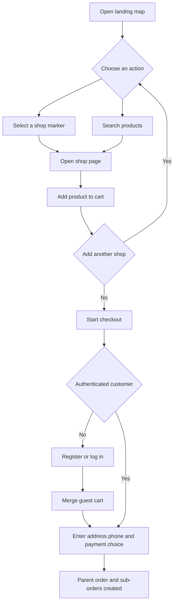
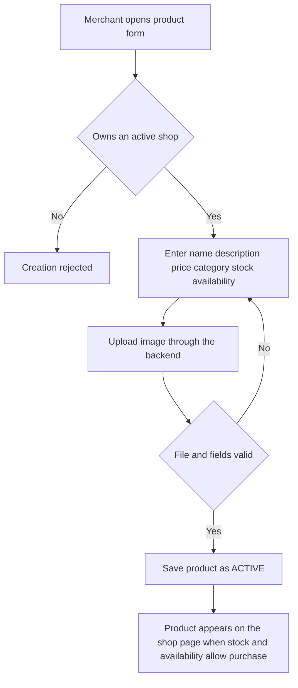
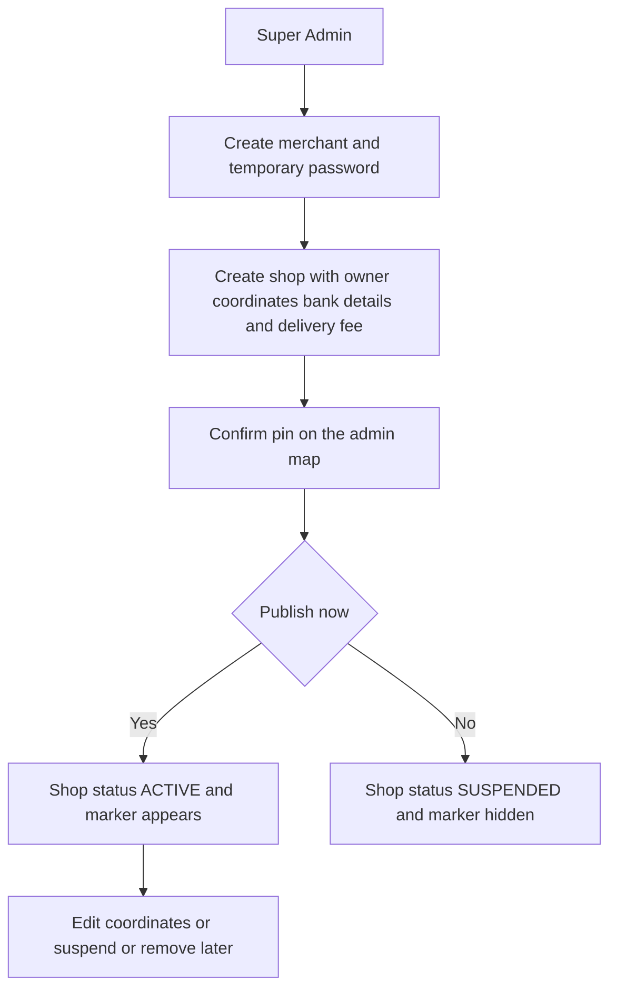

# 2. Functional requirements

Status: proposed specification. Requirement identifiers in this file are the traceability keys used by the API specification, the test plan, and the roadmap.

Related behavior for orders and payments is normative in [07-order-and-payment-workflows.md](07-order-and-payment-workflows.md). This file describes what each actor can do. It does not redefine the state machine.

## 2.1 Customer application

### FR-C-01 Browse without registering

A visitor can open the landing page, shop pages, product pages, and search results without an account. Private pages redirect to login: cart merge is not required for browsing, but checkout, order history, and saved addresses are.

### FR-C-02 Map landing page

The landing page shows a Google Map. The default center is Jimma at latitude `7.6667`, longitude `36.8333`, zoom `13`. That center is a demo default, not a rule that hides shops outside Jimma.

### FR-C-03 Shop markers

Every shop with status `ACTIVE`, whose merchant is `ACTIVE`, appears as a marker at the shop's stored latitude and longitude. Suspended, removed, and shops owned by a suspended merchant are omitted. The marker is not geocoded from a street address at display time. The coordinates saved by the Super Admin are the source of truth.

### FR-C-04 Open a shop from a marker

Selecting a marker shows a preview with shop name, address text, and the count of products currently listed. Choosing the preview navigates to that shop's page. The preview does not show bank account details.

### FR-C-05 Shop page

The shop page shows the shop name, description, address, phone, and map location, plus each visible product's name, description, price, image, category, and whether it can be added to the cart. A product is listed when its status is `ACTIVE` and its shop is visible. A product can be added only when it is also `is_available = true` and `stock_quantity > 0`.

### FR-C-06 Cross-shop product search

The customer can search by text across all visible shops. Results show the product, price, availability, and the shop that sells it. Filters supported by the API are category, shop, minimum price, maximum price, and availability. Search does not look through orders, customers, or receipts.

### FR-C-07 Multi-shop cart

A cart may contain products from more than one shop. The cart presentation groups lines by shop so the customer can see who will fulfill each line.

A visitor's cart lives in browser `localStorage` under the key `cart_guest_v1`. It stores product id and quantity only. Prices shown in the guest cart are read from the catalog at render time. After a customer logs in or registers, the client sends those lines to the merge endpoint. The server cart then becomes the only cart the checkout will use.

### FR-C-08 Login before the first order

Submitting checkout requires an authenticated customer. Adding an item to the guest cart does not. A visitor who chooses checkout is sent through login or registration and returned to checkout after the guest cart is merged.

### FR-C-09 Registration

Registration requires:

| Field | Rule |
|---|---|
| Full name | 2 to 120 characters |
| Username | 3 to 30 characters, letters, digits, and underscore, stored lowercase, unique |
| Password | At least 8 characters |

The proposed password rule is a decision, not a hackathon-verified strength test. Registration does not collect email or phone. Phone is collected at checkout. Email is an open decision because Chapa may require it; see [03-system-architecture.md](03-system-architecture.md#unresolved-architectural-decisions).

The new account has role `CUSTOMER` and status `ACTIVE`.

### FR-C-10 View and modify the cart

An authenticated customer can list cart lines, change a quantity, and remove a line. Setting a quantity above available stock is rejected when the cart is saved, and stock is checked again at checkout. Prices are not stored on the cart. The cart response includes the current catalog price and a flag when that price changed since the client last displayed it.

Clearing the cart removes lines. It does not delete the cart row.

### FR-C-11 Checkout capture

Checkout requires:

| Field | Rule |
|---|---|
| Local address name | 2 to 120 characters. Example: a neighborhood or compound name |
| House number | 1 to 30 characters |
| Phone number | Proposed Ethiopian mobile pattern `^(\+251|0)9\d{8}$` |
| Delivery preference | `DELIVERY` or `PICKUP` |
| Payment method | `CHAPA` or `BANK_TRANSFER` |

The customer may select a saved address instead of typing these three location fields again. Saved addresses belong only to that customer. The order stores a copy of the address fields. Later edits to the address book do not change old orders.

### FR-C-12 Delivery or pickup

`DELIVERY` adds each shop's flat `delivery_fee_etb` to that sub-order. `PICKUP` sets every sub-order delivery fee to zero. The customer still provides address and phone for pickup so the merchant can identify them. The fee model is a proposed default and is listed as an open decision.

### FR-C-13 Payment method choice

The customer selects one method for the whole checkout.

- `CHAPA` pays the parent grand total in one online payment.
- `BANK_TRANSFER` pays each merchant separately. The order response shows that merchant's bank name, account name, and account number. Those bank fields are not included on the public shop page.

### FR-C-14 Order tracking

A customer can list only their own parent orders and open one parent order to see totals, payment method, payment progress, and fulfillment progress.

### FR-C-15 Per-merchant status under one parent

The parent order page lists each merchant sub-order with:

- shop name;
- that shop's items, quantities, and snapshotted prices;
- that sub-order's payment status;
- that sub-order's fulfillment status;
- for bank transfer, whether a receipt has been uploaded and whether the merchant accepted or rejected it.

## 2.2 Merchant dashboard

Merchants do not self-register. `FR-M-01` The Super Admin creates the account, assigns the username, and sets a temporary password. The plaintext password is returned once in that admin response, is not stored, and is not written to the audit log. `must_change_password` is true until the merchant sets a new password. Until that change, the only allowed authenticated call is change-password.

### FR-M-02 Authentication

Merchants log in with username and password. A suspended merchant receives the same generic failure as a bad password on login, and any existing session is rejected on the next request after suspension. Details are in [06-authentication-and-security.md](06-authentication-and-security.md).

### FR-M-03 Dashboard overview

The overview shows, for shops the merchant currently owns:

- count of sub-orders in fulfillment status `NEW`;
- count of bank-transfer payments in `AWAITING_VERIFICATION`;
- paid sales total for the last 7 days and the last 30 days, using sub-order totals where payment status is `PAID` and fulfillment is not `CANCELLED`;
- shop view count and product view count for the last 30 days.

### FR-M-04 Product lifecycle

The merchant can create, edit, and archive products on shops they currently own. Archive is the delete operation. Rows are retained so old order items can keep their product foreign key. Archived products disappear from the public catalog and cannot be added to carts.

### FR-M-05 Product fields

| Field | Rule |
|---|---|
| Name | 2 to 160 characters |
| Description | 1 to 5,000 characters |
| Price | `ETB`, greater than 0, at most two decimal places, maximum `99999999.99` |
| Image | One image, JPEG, PNG, or WebP, maximum 5 MB, stored in Cloudinary |
| Category | An active category |
| Stock | Integer greater than or equal to 0 |
| Availability | Boolean the merchant can turn off without zeroing stock |

### FR-M-06 Order notifications

When a sub-order becomes `NEW`, the merchant receives an in-app notification. A bank-transfer receipt upload also creates a notification. Notifications are listed and marked read only by the recipient.

### FR-M-07 Own orders only

The merchant order list and detail return only sub-orders whose `merchant_id` is the logged-in merchant. The detail includes the parent order number, fulfillment preference, fulfillment contact, own items, own amounts, and own payment status. It omits sibling items, sibling totals, and the parent grand total.

### FR-M-08 Confirmation and status updates

A merchant can confirm a sub-order only when payment status is `PAID` and fulfillment status is `NEW`. Later updates must follow the transitions in the workflow document. The merchant can cancel their own sub-order from `NEW`, `CONFIRMED`, or `PREPARING`.

### FR-M-09 Receipt verification

For a bank-transfer payment on their own sub-order, the merchant can accept or reject the latest receipt. Accept sets that payment to `PAID` and, in the same transaction, moves the sub-order to `NEW`. Reject sets the payment to `REJECTED` and leaves fulfillment at `AWAITING_PAYMENT`. The customer can upload another receipt after a rejection.

### FR-M-10 Sales analytics

The merchant can read paid sales totals, order counts, and units sold for their own sub-orders. They cannot read platform-wide totals or another merchant's figures.

### FR-M-11 Shop and product views

The merchant can read view counts for their shops and products. Unique visitors are distinct `visitor_id` values, not a list of customers.

### FR-M-12 Profile and password

The merchant can view their full name and username and can change their full name and password. Username changes are not offered. Shop coordinates, shop status, and bank details are not merchant-editable. The merchant can view bank details for their own shops so they recognize incoming transfers. Whether a merchant may edit shop description or phone is open; the proposed default is that the Super Admin owns the whole shop profile.

### FR-M-13 Isolation

Every merchant catalog, order, receipt, notification, analytics, and shop query is filtered by ownership. A crafted id for another merchant's resource returns `404` so the API does not reveal that the resource exists.

## 2.3 Super Admin dashboard

The Super Admin has platform-wide read access and is the only role that creates shops, merchant users, and categories.

### FR-A-01 Create and manage shops

Creating a shop requires an existing merchant owner plus the shop profile in `FR-A-04`. The admin can later edit profile fields and transfer future ownership to another merchant. Transfer does not rewrite `merchant_orders.merchant_id` on historical sub-orders.

### FR-A-02 Register merchants

The admin creates a merchant with full name, username, and temporary password. The account role is `MERCHANT`.

### FR-A-03 Temporary credentials

The create response includes the temporary password one time. A separate reset action issues a new temporary password, increments `token_version`, and sets `must_change_password`.

### FR-A-04 Shop details and coordinates

Required shop fields:

| Field | Rule |
|---|---|
| Name | 2 to 160 characters, unique slug generated from the name |
| Description | Up to 5,000 characters |
| Phone | Same proposed phone pattern as checkout |
| Address text | 2 to 300 characters |
| Latitude | `-90` to `90`, up to 6 decimal places |
| Longitude | `-180` to `180`, up to 6 decimal places |
| Merchant owner | An existing merchant user |
| Delivery fee | Flat ETB amount, greater than or equal to 0 |
| Bank name, account name, account number | Required so bank transfer can show instructions |

The admin UI includes a map click that fills latitude and longitude. The stored numbers remain the source of truth.

### FR-A-05 Edit location

A later update may replace latitude, longitude, and address text. The next map load uses the new coordinates. Past orders do not store coordinates because fulfillment uses the customer's address, not a historical shop pin.

### FR-A-06 Shop lifecycle

Allowed shop statuses are `ACTIVE`, `SUSPENDED`, and `REMOVED`.

| Status | Public map and catalog | Existing orders |
|---|---|---|
| `ACTIVE` | Visible, subject to merchant status | Unchanged |
| `SUSPENDED` | Hidden, not purchasable | Remain readable by customer, current merchant, and admin |
| `REMOVED` | Hidden | Retained for foreign keys. This is not a database delete |

### FR-A-07 Merchant lifecycle

The admin can set a merchant to `ACTIVE` or `SUSPENDED`. Suspension increments `token_version`, hides that merchant's shops from the public catalog, and blocks login. It does not delete orders.

### FR-A-08 Categories

The admin can create and update categories: name, description, and active flag. A category that still has products cannot be hard-deleted. Deactivating a category hides it from the product form and from public filters, and products already in it stay listed with their historical category.

### FR-A-09 Monitor customers and merchants

The admin can list and open customer and merchant accounts. The list shows role, status, username, full name, and created time. It never includes password hashes. The proposed admin action set includes suspending a customer for abuse. That action is broader than the literal phrase "monitor customers" and is recorded as an open decision. Merchant activation and suspension are required.

### FR-A-10 Orders and payments

The admin can list and open every parent order, sub-order, payment, and receipt metadata. Admin order screens are read-only in this version. The admin does not confirm fulfillment on behalf of a merchant.

### FR-A-11 Platform analytics

The admin can read platform totals defined in [10-analytics-and-reporting.md](10-analytics-and-reporting.md). Those totals are computed from merchant sub-orders so a parent order is not added on top of its parts.

### FR-A-12 Audit

The following actions append an `audit_logs` row in the same transaction as the change:

- merchant created, suspended, activated, or password reset;
- shop created, updated, or status changed;
- category created or updated;
- customer suspended or activated, if that action is enabled;
- bank-transfer receipt accepted or rejected;
- Chapa payment marked paid or failed by the verification service;
- settlement marked settled or withheld.

The audit row stores the actor, action, entity type, entity id, a JSON diff of non-secret fields, IP address, and user agent. It never stores passwords, access tokens, refresh tokens, or the raw card data (the platform does not handle cards).

## 2.4 Multi-merchant orders

### FR-O-01 One checkout, many shops

Checkout reads the authenticated customer's server cart and groups lines by shop. The customer submits one request and receives one parent order number.

### FR-O-02 Parent order

The parent stores the customer, fulfillment preference, address snapshot, payment method, merchandise subtotal, delivery-fee total, grand total, aggregate payment status, and aggregate fulfillment status.

### FR-O-03 One sub-order per shop

There is exactly one merchant sub-order for each distinct shop in the cart. A second line from the same shop becomes another order item on that same sub-order, not a second sub-order.

### FR-O-04 Items under the sub-order

Each order item belongs to one sub-order and stores quantity, line total, product id, `product_name_snapshot`, and `unit_price_snapshot`.

### FR-O-05 Merchant visibility

Satisfied by `FR-M-07`. The merchant receives their items and the fulfillment contact only.

### FR-O-06 Customer visibility

The customer sees the parent and all of its sub-orders.

### FR-O-07 Admin visibility

The Super Admin sees the parent, all sub-orders, payments, and receipt metadata.

### FR-O-08 Stock validation

Checkout locks every selected product row, checks availability, shop visibility, and quantity, then decrements stock in the same database transaction as the order insert. If any line fails, the whole checkout fails and no order is written. The customer must change the cart and try again. Partial checkout is intentionally unsupported so the Chapa amount cannot disagree with the cart.

### FR-O-09 Historical prices

Later edits to a product's name or price do not update order items. Analytics that describe what was sold use the snapshots. Analytics that describe the current catalog use the product table.

## 2.5 Payments

Payment status and fulfillment status are different columns on both the parent order and the merchant sub-order. A paid sub-order can still be awaiting merchant confirmation. A confirmed sub-order is never inferred to be paid; confirmation itself requires payment status `PAID`.

### FR-P-01 through FR-P-07 Chapa

1. The customer chooses Chapa.
2. The backend creates the parent order, sub-orders, and one Chapa payment for `orders.grand_total`.
3. The backend initializes that payment with Chapa and returns Chapa's checkout URL.
4. The customer pays on Chapa's page.
5. The backend verifies the transaction with Chapa. The browser's return URL is not proof of payment.
6. Successful verification sets the Chapa payment to `PAID`, sets each non-cancelled sub-order payment status to `PAID`, moves those sub-orders to fulfillment `NEW`, and writes settlement rows.
7. Merchant settlement is recorded per sub-order. The proposed platform fee is `0` basis points until the team sets `PLATFORM_FEE_BPS`. Recording an offline payout is an admin action. Automated bank payout is out of scope.

### FR-P-08 through FR-P-13 Bank transfer

1. The customer transfers money to each merchant using the bank details on that sub-order.
2. Bank details belong to the shop and are managed by the Super Admin.
3. The customer uploads one receipt image per merchant payment.
4. The merchant verifies only their own payment.
5. Each sub-order has its own payment status: `PENDING`, `AWAITING_VERIFICATION`, `PAID`, `REJECTED`, or `FAILED`.
6. The parent payment status becomes `PARTIALLY_PAID` when at least one payable sub-order is `PAID` and another is not. The customer sees that progress on the parent order.

### FR-P-14 Separation of status

No code path may copy a fulfillment status into a payment status or the reverse. Aggregation rules for the parent are specified only in the workflow document.

## 2.6 AI shopping assistant

### FR-AI-01 Purpose

The assistant helps a shopper find products. It searches, compares prices, filters by a budget, recommends in-stock products, returns public product details, and names the shops that sell a product.

### FR-AI-02 Prohibited data

The assistant must not be able to retrieve:

- passwords or password hashes;
- usernames tied to a private account action;
- customer addresses, phones, or order history;
- merchant or admin account records;
- orders, sub-orders, payments, or receipts;
- access tokens, refresh tokens, or API keys.

A shopper who is logged in does not grant the assistant extra data. The assistant request does not include the caller's order history or profile.

### FR-AI-03 Enforcement

Access is enforced by a fixed tool list and a read-only public-catalog query path, documented in [09-ai-shopping-assistant.md](09-ai-shopping-assistant.md). The model system prompt is additional guidance, not the control.

## 2.7 Notifications

| Event | Recipient |
|---|---|
| Sub-order becomes `NEW` | That sub-order's merchant |
| Receipt uploaded | That sub-order's merchant |
| Receipt rejected | The customer |
| Fulfillment status changes after `NEW` | The customer |
| Merchant account created | No in-app merchant notification. The admin delivers the temporary password out of band |

There is no email or SMS channel in this version.

## 2.8 Requirement index

| ID | Area |
|---|---|
| FR-C-01 … FR-C-15 | Customer application |
| FR-M-01 … FR-M-13 | Merchant dashboard |
| FR-A-01 … FR-A-12 | Super Admin |
| FR-O-01 … FR-O-09 | Multi-merchant orders |
| FR-P-01 … FR-P-14 | Payments |
| FR-AI-01 … FR-AI-03 | AI assistant |
