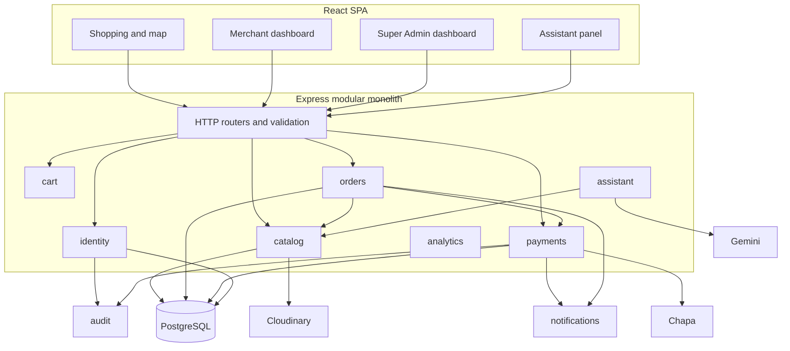

# 3. System architecture

Status: proposed. This file explains how the system should be built. It is not a description of running infrastructure.

The normative order state machine is in [07-order-and-payment-workflows.md](07-order-and-payment-workflows.md). The security controls are in [06-authentication-and-security.md](06-authentication-and-security.md).

## 3.1 Architectural style

The backend is a modular monolith: one Node.js process, one Express application, one PostgreSQL database, and modules that call each other in-process. The frontend is a separate React single-page application.

| Module | Owns |
|---|---|
| `identity` | Users, passwords, tokens, role checks |
| `catalog` | Categories, shops, products, public search |
| `cart` | Server cart and guest-cart merge |
| `orders` | Checkout transaction, parent orders, sub-orders, aggregation |
| `payments` | Chapa initialization and verification, receipts, settlements |
| `notifications` | In-app notifications |
| `analytics` | View events and aggregate reads |
| `audit` | Append-only audit writes |
| `assistant` | Gemini function-calling loop and catalog tools |

A module may read another module's data only through that module's service interface. The assistant module is the exception that is narrower: it may call only `catalog.publicQueries`. It must not import the order, payment, identity, or audit services.

The diagram source is also stored at [diagrams/system-architecture.mmd](diagrams/system-architecture.mmd).

## 3.2 Why a modular monolith fits this hackathon

Checkout must create the parent order, every sub-order, every item, the stock decrement, and the payment row together. A database transaction in one process does that reliably. Splitting orders and catalog into separate services on day one would add network failure between the stock check and the insert, which this team does not need for a hackathon demo.

One Render service and one Supabase database are also cheaper to operate and easier to debug during a short build. Prisma migrations stay linear. Authentication middleware runs once for every role.

The module boundaries are the evolution path:

| Future pressure | What can move out |
|---|---|
| Catalog read traffic dominates | Read replica, then a catalog service behind the same public query interface |
| Payment webhooks need isolation | `payments` process with the same database, still writing through one transaction helper |
| Assistant latency or cost spikes | `assistant` service that can call only the catalog HTTP or SQL role already defined |
| A second region or a very large map | Bounding-box queries and marker clustering are already specified, so the API does not have to change shape |

Until one of those pressures is measured, the team should not split the deployable.

## 3.3 Request path

1. Express assigns a request id.
2. CORS allows only the configured frontend origin.
3. JSON body size is limited. Multipart is used only on upload routes.
4. The auth middleware verifies the access token when the route requires it, loads the user, and rejects a status, role, or `token_version` mismatch.
5. A Zod schema validates the body and query. Controllers do not trust unvalidated input.
6. The service performs the use case. Authorization that depends on ownership happens in the service, not only in the router, so a second caller cannot skip it.
7. Errors are mapped to the JSON envelope in the API specification. Unexpected errors are logged with the request id and returned as a generic `500`.

## 3.4 Checkout boundary

`orders.checkout` is the only writer that may create a parent order. It:

1. Locks the cart and the product rows with `SELECT … FOR UPDATE`.
2. Rejects the request if any line is not purchasable or lacks stock.
3. Inserts `orders`, `merchant_orders`, `order_items`, and either one Chapa `payments` row or one bank-transfer `payments` row per sub-order.
4. Decrements `stock_quantity`.
5. Sets `stock_hold_state = HELD` and `stock_hold_expires_at`.
6. Clears the cart lines.
7. Commits.

Chapa initialization happens after commit. If Chapa's initialize call fails, the order remains `PENDING_PAYMENT` with a `FAILED` payment attempt, the hold stays until expiry or a retry, and the customer can retry initialization. The order insert is not rolled back because of a downstream HTTP failure after a successful commit. Retry is specified in the API and the payment workflow.

A scheduled job inside the same process runs every five minutes. It expires holds according to the workflow document. The job must be safe if two processes ever run it: the update claims rows with `stock_hold_state = HELD` and `stock_hold_expires_at < now()` using a conditional update.

## 3.5 Frontend architecture

Proposed toolchain: Vite, React, TypeScript, Tailwind CSS. The SPA is a client of the API. It does not embed the database URL, the Chapa secret, the Cloudinary secret, or the Gemini key.

| Concern | Proposed approach |
|---|---|
| Server state | TanStack Query, or a similarly small fetch cache |
| Access token | Memory only, never `localStorage` |
| Refresh token | `HttpOnly` cookie set by the API |
| Guest cart | `localStorage` key `cart_guest_v1` |
| Maps | Google Maps JavaScript API loaded in the browser |
| Route protection | UI guard plus the API authorization, which is the real control |

## 3.6 External systems

| System | Who calls it | Secret location |
|---|---|---|
| Google Maps JavaScript API | Browser | Referrer-restricted browser key in the frontend environment |
| Chapa | Backend only | Render environment |
| Cloudinary | Backend only | Render environment |
| Gemini | Backend only | Render environment |
| Supabase PostgreSQL | Backend only | Render environment |

The browser never calls Chapa's secret API, Cloudinary's admin API, or Gemini directly.

## 3.7 Configuration

Runtime configuration is environment variables documented in [12-deployment-and-infrastructure.md](12-deployment-and-infrastructure.md). Business timezone is `Africa/Addis_Ababa`. Currency is `ETB`.

`PLATFORM_FEE_BPS` defaults to `0`. Settlement net amount is `gross - round(gross * PLATFORM_FEE_BPS / 10000)` using half-up rounding to the nearest santim.

## 3.8 Non-functional requirements

Targets below are design goals. They are not measurements. The test plan should record actual results when the system exists. Wording in reviews should stay "target" until then.

### Performance

| Target | Proposed value |
|---|---|
| Public shop list and product search, server time, p95 | Under 300 ms at 500 active products, excluding third-party calls |
| Checkout transaction, server time, p95 | Under 800 ms, excluding the Chapa HTTP call |
| Map payload for 500 active shops | Under 200 KB JSON |
| AI assistant | At most 3 tool rounds per user message |

Pagination defaults to 20 rows and caps at 50. Product search for the hackathon uses `ILIKE` with a trigram index, not a separate search cluster.

### Scalability

The first deployment is one API instance and one Postgres database. Stateless access tokens let a second instance be added behind Render if the hold-expiry job uses the conditional update in section 3.4. The map API accepts a bounding box so the client does not need every shop in the country forever.

### Availability

Hackathon hosting is best-effort on Vercel, Render, and Supabase. There is no multi-region failover in this version. The useful target is: a failed Chapa call does not lose a committed order, and a process restart does not lose orders that were committed.

### Reliability

Checkout is transactional. Payment verification is idempotent on `tx_ref`. Webhook handlers re-read Chapa rather than trusting the posted amount. Stock restoration and payment updates use conditional state transitions so a repeated request does not decrement or increment twice.

### Maintainability

TypeScript on both sides, Zod at the boundary, Prisma for ordinary queries, and a raw transaction for checkout locking. Each module owns its tables. New order states are not added in a controller.

### Accessibility

Target: shop, cart, checkout, and order pages are usable with a keyboard and expose form errors in text. Map markers have a parallel shop list on the same page so discovery does not depend on a pointer. Color is not the only signal for payment or fulfillment status. This target should be checked with an automated scanner and one keyboard pass; it is not yet verified.

### Responsive design

Target viewports are 360 px wide and 1280 px wide. The map stacks above the shop list on narrow screens. Dashboards collapse tables to stacked rows or horizontal scroll with a visible heading row.

### Data integrity

Foreign keys, checks, and unique indexes in the database design are part of the product, not an optimization. Money uses `DECIMAL(12,2)`. Order items keep name and price snapshots. Parent statuses are derived by one aggregation function.

### Security

Security requirements are specified in [06-authentication-and-security.md](06-authentication-and-security.md). A short version of the acceptance bar: a merchant token cannot read another merchant's sub-order, a customer token cannot read another customer's order, and the assistant tool layer has no query that touches private tables.

### Backup and recovery

Proposed targets, to be confirmed against the actual Supabase plan before a public demo:

| Target | Proposed value |
|---|---|
| Recovery point objective | 24 hours |
| Recovery time objective | 4 hours for a database restore onto a new Postgres instance |

Backups are not a substitute for transactional checkout. Receipt images live in Cloudinary and need that account's retention as well as the database URL rows.

### Monitoring and logging

Each request logs method, path template, status, duration, and request id. Logs must not include passwords, tokens, authorization headers, receipt URLs, or full AI prompts. Payment logs may include the internal payment id and Chapa `tx_ref`. The Render log stream is the hackathon baseline. An error-tracking product is optional and not selected.

## 3.9 Unresolved architectural decisions

These items are open. The proposed default is what an implementer should use until the team decides otherwise. When a decision is made, replace the proposed default in this table and update the linked document in the same change.

| ID | Decision | Proposed default | Why it is open |
|---|---|---|---|
| UD-01 | Customer email | Do not add email to registration. If Chapa's current initialize API requires email, collect it on the Chapa checkout request only and store it on that `payments` row | Registration is specified as full name, username, and password. Chapa's public initialize contract commonly requires email |
| UD-02 | Customer password recovery | No self-service reset in this version | There is no email or phone on the account. Phone collected at checkout is not proof of account ownership |
| UD-03 | Chapa webhook signature header | Do not trust the webhook body. Always verify with Chapa's verify endpoint. Confirm any signature header against current Chapa docs during Phase 8 and add it as a second check if documented | Signature header names change and should not be invented here |
| UD-04 | Platform fee | `PLATFORM_FEE_BPS=0`. Still write a settlement row per Chapa-paid sub-order | The requirements ask for settlement considerations, not a fee percentage |
| UD-05 | Refunds | No automated refund API. Cancellation after a captured Chapa payment sets fulfillment to `CANCELLED` and settlement to `WITHHELD`. Money movement is manual | Refund rules were not specified |
| UD-06 | Merchant edits to shop profile | Super Admin owns description, phone, coordinates, fees, bank details, and status. Merchant can view the shop, including bank details | Requirements assign shop setup to the Super Admin |
| UD-07 | Delivery fee | Flat `shops.delivery_fee_etb`, added per shop on delivery, zero on pickup | The example total excludes delivery fees but checkout allows a delivery preference, so a fee model is required |
| UD-08 | Hold windows | Chapa hold 30 minutes. Bank-transfer hold 48 hours. Expiry behaviour follows the workflow document | Business SLAs were not specified |
| UD-09 | Additional Super Admins | One seeded Super Admin. No promotion API | Prevents privilege escalation endpoints that were not requested |
| UD-10 | Customer suspension | Include admin suspend and activate, and audit it | "Complete administrative control" conflicts slightly with "monitor customers". The default favors abuse response |
| UD-11 | Gemini model name | `GEMINI_MODEL` environment variable. Choose the current Flash model when Phase 10 starts | Model ids change |
| UD-12 | React toolchain | Vite SPA | The stack fixes React and a separate Express API. It does not name Vite |
| UD-13 | Guest cart | Browser `localStorage`, merged after login | Browsing is anonymous, and the first forced login is at order placement |
| UD-14 | Geographic coverage | No geofence. Default camera on Jimma | The event is in Jimma. The requirements say coordinates, not a city boundary |
| UD-15 | Argon2 on Render | Prefer Argon2id. If the Render image cannot build the native module, use bcrypt cost 12 and record that fallback here | Native modules sometimes fail in hosted builds |
| UD-16 | Phone pattern | `^(\+251|0)9\d{8}$` | Requirements say phone number but not a format |
| UD-17 | Password minimum | 8 characters | Requirements do not define password policy |
| UD-18 | Low-stock warning | Not a separate feature. Stock `0` is simply not purchasable | A threshold was not requested |

## 3.10 Out of scope reminder

Reviews, coupons, chat, SMS, email delivery, automated payout files, tax, native apps, and a second currency are out of scope. They should not appear as endpoints during implementation unless this specification is revised.
