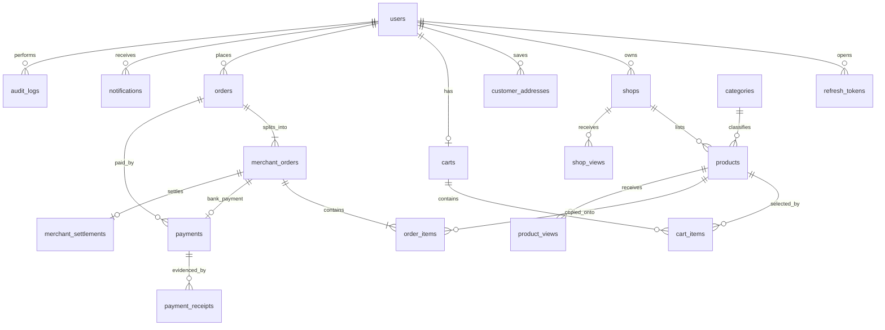

# 4. Database design

Status: proposed PostgreSQL schema. No migration has been created. The Prisma block at the end is a proposal inside this document, not an application file.

The state machines stored in `payment_status` and `fulfillment_status` are defined in [07-order-and-payment-workflows.md](07-order-and-payment-workflows.md). This file defines structure and constraints.

## 4.1 Design rules

- Primary keys are UUIDs generated by the database.
- Table and column names use `snake_case`.
- Money is `DECIMAL(12,2)` in ETB. Application code uses decimal arithmetic.
- Timestamps are `timestamptz`, stored in UTC, presented in `Africa/Addis_Ababa`.
- Users, shops, products, and orders are not hard-deleted. Shops use `REMOVED`. Products use `ARCHIVED`. Users use `SUSPENDED`.
- Order items copy `product_name_snapshot` and `unit_price_snapshot` at checkout.
- Merchant sub-orders copy `merchant_id` and `shop_name_snapshot` at checkout. A later change of `shops.merchant_id` does not move historical orders.
- Private tables are not granted to the optional catalog-reader database role described in the AI document.

## 4.2 Entity descriptions

| Entity | Why it exists |
|---|---|
| `users` | One identity for customers, merchants, and the Super Admin |
| `refresh_tokens` | Revocable server-side sessions. The cookie stores an opaque token; the table stores its hash |
| `shops` | A physical merchant location, its pin, delivery fee, and bank account |
| `categories` | Admin-managed product classification |
| `products` | A sellable item owned by one shop |
| `carts` | One server cart per customer |
| `cart_items` | Quantity of a product in a cart. Price is not stored |
| `customer_addresses` | Reusable checkout addresses for one customer |
| `orders` | Parent customer order |
| `merchant_orders` | One shop's sub-order, including fulfillment contact and both statuses |
| `order_items` | Historical lines belonging to one sub-order |
| `payments` | One Chapa payment for a parent order, or one bank-transfer payment for a sub-order |
| `payment_receipts` | Uploaded proof for a bank-transfer payment |
| `merchant_settlements` | Ledger row for a Chapa-paid sub-order. Not used for bank transfer |
| `product_views` | Append-only product view events |
| `shop_views` | Append-only shop view events |
| `notifications` | In-app notifications for one recipient |
| `audit_logs` | Append-only record of administrative and payment-verification actions |

`refresh_tokens` and `merchant_settlements` are included because authentication must be revocable and Chapa payouts must be traceable. They are not extra product features.

## 4.3 Entity relationship diagram



The full attribute diagram is [diagrams/database-erd.mmd](diagrams/database-erd.mmd).

## 4.4 Table specifications

### users

| Column | Type | Constraints | Notes |
|---|---|---|---|
| `id` | `uuid` | PK, default `gen_random_uuid()` | |
| `role` | enum `user_role` | NOT NULL | `CUSTOMER`, `MERCHANT`, `SUPER_ADMIN` |
| `status` | enum `user_status` | NOT NULL, default `ACTIVE` | `ACTIVE`, `SUSPENDED` |
| `full_name` | `varchar(120)` | NOT NULL | |
| `username` | `varchar(30)` | NOT NULL, unique | Stored lowercase |
| `password_hash` | `text` | NOT NULL | Argon2id or bcrypt string |
| `must_change_password` | `boolean` | NOT NULL, default `false` | True for new merchants |
| `token_version` | `integer` | NOT NULL, default `0` | Incremented to revoke access tokens |
| `last_login_at` | `timestamptz` | NULL | |
| `created_at` | `timestamptz` | NOT NULL, default `now()` | |
| `updated_at` | `timestamptz` | NOT NULL | |

### refresh_tokens

| Column | Type | Constraints | Notes |
|---|---|---|---|
| `id` | `uuid` | PK | |
| `user_id` | `uuid` | NOT NULL, FK `users.id` ON DELETE CASCADE | |
| `token_hash` | `char(64)` | NOT NULL, unique | SHA-256 hex of the opaque token |
| `expires_at` | `timestamptz` | NOT NULL | |
| `revoked_at` | `timestamptz` | NULL | Set on logout or rotation |
| `ip_address` | `varchar(45)` | NULL | |
| `user_agent` | `varchar(300)` | NULL | Truncated |
| `created_at` | `timestamptz` | NOT NULL, default `now()` | |

### shops

| Column | Type | Constraints | Notes |
|---|---|---|---|
| `id` | `uuid` | PK | |
| `merchant_id` | `uuid` | NOT NULL, FK `users.id` RESTRICT | Current owner. Must be a merchant |
| `name` | `varchar(160)` | NOT NULL | |
| `slug` | `varchar(180)` | NOT NULL, unique | Generated from name |
| `description` | `varchar(5000)` | NOT NULL | |
| `phone` | `varchar(20)` | NOT NULL | |
| `address_text` | `varchar(300)` | NOT NULL | |
| `latitude` | `decimal(9,6)` | NOT NULL | Check `-90` to `90` |
| `longitude` | `decimal(9,6)` | NOT NULL | Check `-180` to `180` |
| `status` | enum `shop_status` | NOT NULL, default `ACTIVE` | `ACTIVE`, `SUSPENDED`, `REMOVED` |
| `delivery_fee_etb` | `decimal(12,2)` | NOT NULL, default `0` | Check `>= 0` |
| `bank_name` | `varchar(120)` | NOT NULL | Hidden on public reads |
| `bank_account_name` | `varchar(160)` | NOT NULL | Hidden on public reads |
| `bank_account_number` | `varchar(40)` | NOT NULL | Hidden on public reads |
| `created_at` | `timestamptz` | NOT NULL | |
| `updated_at` | `timestamptz` | NOT NULL | |

The merchant-role check on `merchant_id` is a trigger or an application transaction that locks the user row. PostgreSQL check constraints cannot subquery another table.

### categories

| Column | Type | Constraints | Notes |
|---|---|---|---|
| `id` | `uuid` | PK | |
| `name` | `varchar(80)` | NOT NULL, unique | |
| `slug` | `varchar(100)` | NOT NULL, unique | |
| `description` | `varchar(500)` | NULL | |
| `is_active` | `boolean` | NOT NULL, default `true` | |
| `created_at` | `timestamptz` | NOT NULL | |
| `updated_at` | `timestamptz` | NOT NULL | |

### products

| Column | Type | Constraints | Notes |
|---|---|---|---|
| `id` | `uuid` | PK | |
| `shop_id` | `uuid` | NOT NULL, FK `shops.id` RESTRICT | |
| `category_id` | `uuid` | NOT NULL, FK `categories.id` RESTRICT | |
| `name` | `varchar(160)` | NOT NULL | |
| `description` | `varchar(5000)` | NOT NULL | |
| `price` | `decimal(12,2)` | NOT NULL | Check `> 0` |
| `image_url` | `text` | NOT NULL | Cloudinary URL for a public product image |
| `stock_quantity` | `integer` | NOT NULL | Check `>= 0` |
| `is_available` | `boolean` | NOT NULL, default `true` | |
| `status` | enum `product_status` | NOT NULL, default `ACTIVE` | `ACTIVE`, `ARCHIVED` |
| `created_at` | `timestamptz` | NOT NULL | |
| `updated_at` | `timestamptz` | NOT NULL | |

### carts and cart_items

`carts`: `id` PK, `user_id` NOT NULL unique FK `users.id` CASCADE, `created_at`, `updated_at`.

`cart_items`: `id` PK, `cart_id` FK CASCADE, `product_id` FK RESTRICT, `quantity` integer check `> 0` and `<= 99`, timestamps. Unique `(cart_id, product_id)`.

### customer_addresses

| Column | Type | Constraints | Notes |
|---|---|---|---|
| `id` | `uuid` | PK | |
| `user_id` | `uuid` | NOT NULL, FK `users.id` CASCADE | |
| `address_name` | `varchar(120)` | NOT NULL | Local address name |
| `house_number` | `varchar(30)` | NOT NULL | |
| `phone_number` | `varchar(20)` | NOT NULL | |
| `is_default` | `boolean` | NOT NULL, default `false` | At most one default per user |
| `created_at` | `timestamptz` | NOT NULL | |
| `updated_at` | `timestamptz` | NOT NULL | |

Partial unique index: `(user_id) WHERE is_default`.

### orders

| Column | Type | Constraints | Notes |
|---|---|---|---|
| `id` | `uuid` | PK | |
| `order_number` | `varchar(24)` | NOT NULL, unique | `ORD-YYYYMMDD-####` in Addis Ababa date |
| `customer_id` | `uuid` | NOT NULL, FK `users.id` RESTRICT | |
| `client_request_id` | `varchar(80)` | NULL, unique | Idempotency key from the client |
| `fulfillment_preference` | enum | NOT NULL | `DELIVERY`, `PICKUP` |
| `address_name` | `varchar(120)` | NOT NULL | Snapshot |
| `house_number` | `varchar(30)` | NOT NULL | Snapshot |
| `phone_number` | `varchar(20)` | NOT NULL | Snapshot |
| `payment_method` | enum | NOT NULL | `CHAPA`, `BANK_TRANSFER` |
| `merchandise_subtotal` | `decimal(12,2)` | NOT NULL | Check `>= 0` |
| `delivery_fee_total` | `decimal(12,2)` | NOT NULL | Check `>= 0` |
| `grand_total` | `decimal(12,2)` | NOT NULL | Check equals merchandise plus delivery |
| `payment_status` | enum `parent_payment_status` | NOT NULL | `UNPAID`, `PARTIALLY_PAID`, `PAID`, `FAILED` |
| `fulfillment_status` | enum `parent_fulfillment_status` | NOT NULL | `PENDING_PAYMENT`, `PROCESSING`, `PARTIALLY_FULFILLED`, `FULFILLED`, `CANCELLED` |
| `stock_hold_state` | enum | NOT NULL | `HELD`, `COMMITTED`, `RELEASED` |
| `stock_hold_expires_at` | `timestamptz` | NULL | Null once committed |
| `created_at` | `timestamptz` | NOT NULL | |
| `updated_at` | `timestamptz` | NOT NULL | |

`grand_total = merchandise_subtotal + delivery_fee_total` is a check constraint.

### merchant_orders

| Column | Type | Constraints | Notes |
|---|---|---|---|
| `id` | `uuid` | PK | |
| `order_id` | `uuid` | NOT NULL, FK `orders.id` CASCADE | |
| `shop_id` | `uuid` | NOT NULL, FK `shops.id` RESTRICT | |
| `merchant_id` | `uuid` | NOT NULL, FK `users.id` RESTRICT | Owner at purchase time |
| `shop_name_snapshot` | `varchar(160)` | NOT NULL | |
| `customer_full_name` | `varchar(120)` | NOT NULL | Fulfillment contact |
| `address_name` | `varchar(120)` | NOT NULL | |
| `house_number` | `varchar(30)` | NOT NULL | |
| `phone_number` | `varchar(20)` | NOT NULL | |
| `subtotal` | `decimal(12,2)` | NOT NULL | Sum of line totals |
| `delivery_fee` | `decimal(12,2)` | NOT NULL | |
| `total` | `decimal(12,2)` | NOT NULL | `subtotal + delivery_fee` |
| `payment_status` | enum `merchant_payment_status` | NOT NULL | `PENDING`, `AWAITING_VERIFICATION`, `PAID`, `FAILED`, `REJECTED` |
| `fulfillment_status` | enum `merchant_fulfillment_status` | NOT NULL | See workflow document |
| `cancellation_reason` | `varchar(300)` | NULL | Required by the app when cancelled |
| `created_at` | `timestamptz` | NOT NULL | |
| `updated_at` | `timestamptz` | NOT NULL | |

Unique `(order_id, shop_id)`.

Merchant fulfillment values: `AWAITING_PAYMENT`, `NEW`, `CONFIRMED`, `PREPARING`, `READY_FOR_PICKUP`, `OUT_FOR_DELIVERY`, `COMPLETED`, `CANCELLED`.

### order_items

| Column | Type | Constraints | Notes |
|---|---|---|---|
| `id` | `uuid` | PK | |
| `merchant_order_id` | `uuid` | NOT NULL, FK `merchant_orders.id` CASCADE | |
| `product_id` | `uuid` | NOT NULL, FK `products.id` RESTRICT | Remains after archive |
| `product_name_snapshot` | `varchar(160)` | NOT NULL | Historical name |
| `unit_price_snapshot` | `decimal(12,2)` | NOT NULL | Historical unit price |
| `quantity` | `integer` | NOT NULL | Check `> 0` |
| `line_total` | `decimal(12,2)` | NOT NULL | Check equals unit price times quantity |
| `created_at` | `timestamptz` | NOT NULL | |

There is no `updated_at`. An order item is immutable after insert.

### payments

| Column | Type | Constraints | Notes |
|---|---|---|---|
| `id` | `uuid` | PK | |
| `order_id` | `uuid` | NOT NULL, FK `orders.id` RESTRICT | Always set |
| `merchant_order_id` | `uuid` | NULL, FK `merchant_orders.id` RESTRICT | Null for Chapa; set for bank transfer |
| `method` | enum `payment_method` | NOT NULL | `CHAPA` or `BANK_TRANSFER` |
| `amount` | `decimal(12,2)` | NOT NULL | Check `> 0` |
| `currency` | `char(3)` | NOT NULL, default `ETB` | Check `= 'ETB'` |
| `status` | enum `payment_record_status` | NOT NULL | `PENDING`, `PROCESSING`, `AWAITING_VERIFICATION`, `PAID`, `FAILED`, `REJECTED`, `EXPIRED` |
| `provider` | enum | NOT NULL | `CHAPA` or `MANUAL` |
| `tx_ref` | `varchar(80)` | NULL, unique | Chapa reference. Null for bank transfer |
| `provider_reference` | `varchar(120)` | NULL | Chapa transaction id after verify |
| `checkout_url` | `text` | NULL | Chapa hosted page |
| `payer_email` | `varchar(254)` | NULL | Only if UD-01 requires an email for Chapa |
| `verified_at` | `timestamptz` | NULL | |
| `verified_by_user_id` | `uuid` | NULL, FK `users.id` | Merchant for bank transfer; null when the verifier is the Chapa job |
| `failure_reason` | `varchar(300)` | NULL | Safe message, no provider secrets |
| `created_at` | `timestamptz` | NOT NULL | |
| `updated_at` | `timestamptz` | NOT NULL | |

Checks:

- `method = 'CHAPA'` implies `merchant_order_id IS NULL` and `provider = 'CHAPA'`.
- `method = 'BANK_TRANSFER'` implies `merchant_order_id IS NOT NULL` and `provider = 'MANUAL'`.
- Chapa amount equals the parent `grand_total` at insert time. The application checks this inside the checkout transaction. A later cancellation does not rewrite the captured amount.
- At most one open Chapa payment per order: unique `order_id` where `method = 'CHAPA' AND status IN ('PENDING','PROCESSING')`.
- At most one bank payment per sub-order: unique `merchant_order_id` where `method = 'BANK_TRANSFER'`.

### payment_receipts

| Column | Type | Constraints | Notes |
|---|---|---|---|
| `id` | `uuid` | PK | |
| `payment_id` | `uuid` | NOT NULL, FK `payments.id` RESTRICT | Bank-transfer payments only |
| `uploaded_by_user_id` | `uuid` | NOT NULL, FK `users.id` RESTRICT | The customer |
| `image_url` | `text` | NOT NULL | Not a public catalog URL |
| `cloudinary_public_id` | `varchar(200)` | NOT NULL | |
| `note` | `varchar(300)` | NULL | |
| `created_at` | `timestamptz` | NOT NULL | |

A new upload is allowed when the payment is `PENDING` or `REJECTED`. The application enforces that. Receipt files are private; see the security document.

### merchant_settlements

| Column | Type | Constraints | Notes |
|---|---|---|---|
| `id` | `uuid` | PK | |
| `merchant_order_id` | `uuid` | NOT NULL, unique, FK RESTRICT | One ledger row |
| `shop_id` | `uuid` | NOT NULL, FK RESTRICT | |
| `merchant_id` | `uuid` | NOT NULL, FK RESTRICT | Merchant at purchase time |
| `gross_amount` | `decimal(12,2)` | NOT NULL | Sub-order total |
| `platform_fee_amount` | `decimal(12,2)` | NOT NULL | Check `>= 0` |
| `net_amount` | `decimal(12,2)` | NOT NULL | Check `gross = fee + net` |
| `status` | enum | NOT NULL | `PENDING`, `SETTLED`, `WITHHELD` |
| `settled_at` | `timestamptz` | NULL | |
| `settled_by_user_id` | `uuid` | NULL, FK `users.id` | Super Admin who recorded the offline payout |
| `reference_note` | `varchar(200)` | NULL | Bank reference entered by admin. Not a secret key |
| `created_at` | `timestamptz` | NOT NULL | |

Rows are created only after Chapa verification. Bank transfer does not create a settlement, because the customer paid the merchant directly.

### product_views and shop_views

Both tables are append-only.

| Column | Type | Constraints |
|---|---|---|
| `id` | `uuid` | PK |
| `product_id` or `shop_id` | `uuid` | NOT NULL, FK RESTRICT |
| `viewer_user_id` | `uuid` | NULL, FK `users.id` SET NULL |
| `visitor_id` | `varchar(64)` | NOT NULL |
| `viewed_at` | `timestamptz` | NOT NULL, default `now()` |

`visitor_id` is a random id generated in the browser. It is not an account id. Authenticated views may also set `viewer_user_id`. Analytics must still work if it is null.

### notifications

| Column | Type | Constraints | Notes |
|---|---|---|---|
| `id` | `uuid` | PK | |
| `recipient_user_id` | `uuid` | NOT NULL, FK `users.id` CASCADE | |
| `type` | `varchar(60)` | NOT NULL | Application enum, see below |
| `title` | `varchar(140)` | NOT NULL | |
| `body` | `varchar(500)` | NOT NULL | |
| `data` | `jsonb` | NOT NULL, default `{}` | Ids only, no receipt URLs |
| `read_at` | `timestamptz` | NULL | |
| `created_at` | `timestamptz` | NOT NULL | |

`type` values: `MERCHANT_ORDER_NEW`, `RECEIPT_UPLOADED`, `RECEIPT_REJECTED`, `FULFILLMENT_UPDATED`.

### audit_logs

| Column | Type | Constraints | Notes |
|---|---|---|---|
| `id` | `uuid` | PK | |
| `actor_user_id` | `uuid` | NULL, FK `users.id` SET NULL | Null only if the actor row is later removed, which this version does not do |
| `action` | `varchar(80)` | NOT NULL | |
| `entity_type` | `varchar(40)` | NOT NULL | |
| `entity_id` | `uuid` | NULL | |
| `metadata` | `jsonb` | NOT NULL | Non-secret before/after values |
| `ip_address` | `varchar(45)` | NULL | |
| `user_agent` | `varchar(300)` | NULL | |
| `created_at` | `timestamptz` | NOT NULL | |

The application role may insert and select audit logs. It should not update or delete them. That restriction is a database privilege, not a convention.

## 4.5 Relationship explanations

| From | To | Cardinality | Meaning |
|---|---|---|---|
| User | Shop | One merchant to many shops | Current ownership |
| User | Order | One customer to many parent orders | A merchant user does not place customer orders in this version |
| Order | Merchant order | One to many, at least one | Created together |
| Merchant order | Order item | One to many, at least one | A sub-order without items is invalid. Enforced by the checkout transaction |
| Shop | Merchant order | One to many | Historical `merchant_id` can differ from the shop's current owner |
| Order | Payment | One to many attempts | Chapa retries add attempts; only one may be open |
| Merchant order | Payment | One to zero or one | Present for bank transfer, absent for Chapa |
| Payment | Receipt | One to many | Several uploads after rejection |
| Merchant order | Settlement | One to zero or one | Present after successful Chapa verification |
| Product | Order item | One to many | Product archive does not remove items |
| Category | Product | One to many | |
| Cart | Cart item | One to many | Unique product inside a cart |
| User | Address | One to many | |

Parent totals are the sum of sub-order amounts at insert time:

- `merchandise_subtotal` equals the sum of `merchant_orders.subtotal`.
- `delivery_fee_total` equals the sum of `merchant_orders.delivery_fee`.
- Each `subtotal` equals the sum of its items' `line_total`.

Those equalities are checked in the checkout transaction. They are not continuously rewritten when a sub-order is later cancelled. Cancellation is represented by status, not by deleting history. The customer UI shows original lines and a cancelled state. Amount still due for bank transfer ignores cancelled sub-orders. That rule lives in the workflow document so the schema does not destroy the snapshot.

## 4.6 Integrity rules that application code must enforce

The database holds the structural rules. These rules need a transaction because they cross rows:

1. Checkout either commits every insert and stock decrement, or commits nothing.
2. Product locks are `SELECT … FOR UPDATE` ordered by product id, so two checkouts cannot deadlock by locking in opposite orders.
3. A line is purchasable only when the product is `ACTIVE`, `is_available`, stock is sufficient, the shop is `ACTIVE`, the merchant is `ACTIVE`, and the category is `ACTIVE`.
4. Parent `payment_status` and `fulfillment_status` are written only by the aggregation function.
5. A merchant status change checks `merchant_orders.merchant_id`, not the shop's current owner.
6. Receipt upload checks that the payment's order belongs to the customer and the method is `BANK_TRANSFER`.
7. Settlement rows are inserted in the same transaction as the Chapa `PAID` transition.
8. Audit insert commits with the mutation it describes.

Stock hold release increments `stock_quantity` by the sub-order quantities once, and only from `HELD` to `RELEASED`. Cancellation of a still-held unpaid sub-order returns that sub-order's stock immediately. Cancellation after `COMMITTED` also returns stock once. The implementation must use a per-sub-order "stock returned" guard. Proposed column-free guard: return stock only in the transition into `CANCELLED` from a state that had taken stock, inside the same transaction, and never on a second cancel call because the second call sees `CANCELLED` and stops.

Chapa hold expiry releases stock for the whole order only when the parent is still `PENDING_PAYMENT` and no payment is `PAID`. Bank-transfer expiry cancels and restocks only sub-orders that are still unpaid; paid sub-orders stay committed. If every remaining sub-order is cancelled, the parent becomes `CANCELLED` and the order hold becomes `RELEASED`. If some remain paid, the order hold becomes `COMMITTED`.

## 4.7 Indexing

| Index | Purpose |
|---|---|
| `users (username)` unique | Login |
| `users (role, status)` | Admin lists |
| `shops (slug)` unique | Shop page |
| `shops (status, latitude, longitude)` | Map and bounding box |
| `shops (merchant_id)` | Merchant isolation |
| `products (shop_id, status)` | Shop page |
| `products (category_id)` | Filters |
| GIN trigram on `products.name` | Search. Raw SQL migration; Prisma cannot express it cleanly |
| `cart_items (cart_id, product_id)` unique | Merge and add |
| `orders (customer_id, created_at DESC)` | Customer order list |
| `orders (order_number)` unique | Support lookup |
| `merchant_orders (merchant_id, fulfillment_status, created_at DESC)` | Merchant queue |
| `merchant_orders (order_id)` | Parent detail |
| Unique `(order_id, shop_id)` | One sub-order per shop |
| `order_items (merchant_order_id)` | Detail |
| `payments (tx_ref)` unique | Idempotent Chapa verify |
| Partial unique open Chapa payment | Prevent double initialize |
| Partial unique bank payment per sub-order | One receivable |
| `payment_receipts (payment_id, created_at DESC)` | Latest receipt |
| `product_views (product_id, viewed_at DESC)` | Analytics |
| `shop_views (shop_id, viewed_at DESC)` | Analytics |
| `notifications (recipient_user_id, created_at DESC)` | Inbox |
| `audit_logs (created_at DESC)` | Admin review |
| `audit_logs (entity_type, entity_id)` | Entity history |
| `merchant_settlements (merchant_id, status)` | Payout queue |

Bounding-box map queries can use the latitude/longitude index for a hackathon data size. A GiST index on a generated `geography` point is a later optimization, not a Phase 1 requirement.

## 4.8 Prisma proposal

This block is documentation. Do not treat it as a generated client that already exists.

```prisma
generator client {
  provider = "prisma-client-js"
}

datasource db {
  provider = "postgresql"
  url      = env("DATABASE_URL")
}

enum UserRole {
  CUSTOMER
  MERCHANT
  SUPER_ADMIN
}

enum UserStatus {
  ACTIVE
  SUSPENDED
}

enum ShopStatus {
  ACTIVE
  SUSPENDED
  REMOVED
}

enum ProductStatus {
  ACTIVE
  ARCHIVED
}

enum FulfillmentPreference {
  DELIVERY
  PICKUP
}

enum PaymentMethod {
  CHAPA
  BANK_TRANSFER
}

enum ParentPaymentStatus {
  UNPAID
  PARTIALLY_PAID
  PAID
  FAILED
}

enum ParentFulfillmentStatus {
  PENDING_PAYMENT
  PROCESSING
  PARTIALLY_FULFILLED
  FULFILLED
  CANCELLED
}

enum MerchantPaymentStatus {
  PENDING
  AWAITING_VERIFICATION
  PAID
  FAILED
  REJECTED
}

enum MerchantFulfillmentStatus {
  AWAITING_PAYMENT
  NEW
  CONFIRMED
  PREPARING
  READY_FOR_PICKUP
  OUT_FOR_DELIVERY
  COMPLETED
  CANCELLED
}

enum PaymentRecordStatus {
  PENDING
  PROCESSING
  AWAITING_VERIFICATION
  PAID
  FAILED
  REJECTED
  EXPIRED
}

enum PaymentProvider {
  CHAPA
  MANUAL
}

enum StockHoldState {
  HELD
  COMMITTED
  RELEASED
}

enum SettlementStatus {
  PENDING
  SETTLED
  WITHHELD
}

model User {
  id                 String     @id @default(uuid()) @db.Uuid
  role               UserRole
  status             UserStatus @default(ACTIVE)
  fullName           String     @map("full_name") @db.VarChar(120)
  username           String     @unique @db.VarChar(30)
  passwordHash       String     @map("password_hash")
  mustChangePassword Boolean    @default(false) @map("must_change_password")
  tokenVersion       Int        @default(0) @map("token_version")
  lastLoginAt        DateTime?  @map("last_login_at")
  createdAt          DateTime   @default(now()) @map("created_at")
  updatedAt          DateTime   @updatedAt @map("updated_at")

  refreshTokens      RefreshToken[]
  ownedShops         Shop[]                  @relation("ShopOwner")
  addresses          CustomerAddress[]
  cart               Cart?
  orders             Order[]                 @relation("CustomerOrders")
  merchantOrders     MerchantOrder[]         @relation("SubOrderMerchant")
  notifications      Notification[]
  auditLogs          AuditLog[]
  productViews       ProductView[]
  shopViews          ShopView[]
  uploadedReceipts   PaymentReceipt[]
  verifiedPayments   Payment[]               @relation("PaymentVerifier")
  settlementsOwed    MerchantSettlement[]    @relation("SettlementMerchant")
  settlementsMarked  MerchantSettlement[]    @relation("SettlementActor")

  @@index([role, status])
  @@map("users")
}

model RefreshToken {
  id        String    @id @default(uuid()) @db.Uuid
  userId    String    @map("user_id") @db.Uuid
  tokenHash String    @unique @map("token_hash") @db.Char(64)
  expiresAt DateTime  @map("expires_at")
  revokedAt DateTime? @map("revoked_at")
  ipAddress String?   @map("ip_address") @db.VarChar(45)
  userAgent String?   @map("user_agent") @db.VarChar(300)
  createdAt DateTime  @default(now()) @map("created_at")
  user      User      @relation(fields: [userId], references: [id], onDelete: Cascade)

  @@index([userId])
  @@map("refresh_tokens")
}

model Shop {
  id                String     @id @default(uuid()) @db.Uuid
  merchantId        String     @map("merchant_id") @db.Uuid
  name              String     @db.VarChar(160)
  slug              String     @unique @db.VarChar(180)
  description       String     @db.VarChar(5000)
  phone             String     @db.VarChar(20)
  addressText       String     @map("address_text") @db.VarChar(300)
  latitude          Decimal    @db.Decimal(9, 6)
  longitude         Decimal    @db.Decimal(9, 6)
  status            ShopStatus @default(ACTIVE)
  deliveryFeeEtb    Decimal    @default(0) @map("delivery_fee_etb") @db.Decimal(12, 2)
  bankName          String     @map("bank_name") @db.VarChar(120)
  bankAccountName   String     @map("bank_account_name") @db.VarChar(160)
  bankAccountNumber String     @map("bank_account_number") @db.VarChar(40)
  createdAt         DateTime   @default(now()) @map("created_at")
  updatedAt         DateTime   @updatedAt @map("updated_at")
  merchant          User       @relation("ShopOwner", fields: [merchantId], references: [id])
  products          Product[]
  merchantOrders    MerchantOrder[]
  shopViews         ShopView[]
  settlements       MerchantSettlement[]

  @@index([merchantId])
  @@index([status, latitude, longitude])
  @@map("shops")
}

model Category {
  id          String    @id @default(uuid()) @db.Uuid
  name        String    @unique @db.VarChar(80)
  slug        String    @unique @db.VarChar(100)
  description String?   @db.VarChar(500)
  isActive    Boolean   @default(true) @map("is_active")
  createdAt   DateTime  @default(now()) @map("created_at")
  updatedAt   DateTime  @updatedAt @map("updated_at")
  products    Product[]

  @@map("categories")
}

model Product {
  id             String        @id @default(uuid()) @db.Uuid
  shopId         String        @map("shop_id") @db.Uuid
  categoryId     String        @map("category_id") @db.Uuid
  name           String        @db.VarChar(160)
  description    String        @db.VarChar(5000)
  price          Decimal       @db.Decimal(12, 2)
  imageUrl       String        @map("image_url")
  stockQuantity  Int           @map("stock_quantity")
  isAvailable    Boolean       @default(true) @map("is_available")
  status         ProductStatus @default(ACTIVE)
  createdAt      DateTime      @default(now()) @map("created_at")
  updatedAt      DateTime      @updatedAt @map("updated_at")
  shop           Shop          @relation(fields: [shopId], references: [id])
  category       Category      @relation(fields: [categoryId], references: [id])
  cartItems      CartItem[]
  orderItems     OrderItem[]
  productViews   ProductView[]

  @@index([shopId, status])
  @@index([categoryId])
  @@map("products")
}

model Cart {
  id        String     @id @default(uuid()) @db.Uuid
  userId    String     @unique @map("user_id") @db.Uuid
  createdAt DateTime   @default(now()) @map("created_at")
  updatedAt DateTime   @updatedAt @map("updated_at")
  user      User       @relation(fields: [userId], references: [id], onDelete: Cascade)
  items     CartItem[]

  @@map("carts")
}

model CartItem {
  id        String   @id @default(uuid()) @db.Uuid
  cartId    String   @map("cart_id") @db.Uuid
  productId String   @map("product_id") @db.Uuid
  quantity  Int
  createdAt DateTime @default(now()) @map("created_at")
  updatedAt DateTime @updatedAt @map("updated_at")
  cart      Cart     @relation(fields: [cartId], references: [id], onDelete: Cascade)
  product   Product  @relation(fields: [productId], references: [id])

  @@unique([cartId, productId])
  @@map("cart_items")
}

model CustomerAddress {
  id          String   @id @default(uuid()) @db.Uuid
  userId      String   @map("user_id") @db.Uuid
  addressName String   @map("address_name") @db.VarChar(120)
  houseNumber String   @map("house_number") @db.VarChar(30)
  phoneNumber String   @map("phone_number") @db.VarChar(20)
  isDefault   Boolean  @default(false) @map("is_default")
  createdAt   DateTime @default(now()) @map("created_at")
  updatedAt   DateTime @updatedAt @map("updated_at")
  user        User     @relation(fields: [userId], references: [id], onDelete: Cascade)

  @@index([userId])
  @@map("customer_addresses")
}

model Order {
  id                    String                  @id @default(uuid()) @db.Uuid
  orderNumber           String                  @unique @map("order_number") @db.VarChar(24)
  customerId            String                  @map("customer_id") @db.Uuid
  clientRequestId       String?                 @unique @map("client_request_id") @db.VarChar(80)
  fulfillmentPreference FulfillmentPreference   @map("fulfillment_preference")
  addressName           String                  @map("address_name") @db.VarChar(120)
  houseNumber           String                  @map("house_number") @db.VarChar(30)
  phoneNumber           String                  @map("phone_number") @db.VarChar(20)
  paymentMethod         PaymentMethod           @map("payment_method")
  merchandiseSubtotal   Decimal                 @map("merchandise_subtotal") @db.Decimal(12, 2)
  deliveryFeeTotal      Decimal                 @map("delivery_fee_total") @db.Decimal(12, 2)
  grandTotal            Decimal                 @map("grand_total") @db.Decimal(12, 2)
  paymentStatus         ParentPaymentStatus     @map("payment_status")
  fulfillmentStatus     ParentFulfillmentStatus @map("fulfillment_status")
  stockHoldState        StockHoldState          @map("stock_hold_state")
  stockHoldExpiresAt    DateTime?               @map("stock_hold_expires_at")
  createdAt             DateTime                @default(now()) @map("created_at")
  updatedAt             DateTime                @updatedAt @map("updated_at")
  customer              User                    @relation("CustomerOrders", fields: [customerId], references: [id])
  merchantOrders        MerchantOrder[]
  payments              Payment[]

  @@index([customerId, createdAt])
  @@map("orders")
}

model MerchantOrder {
  id                  String                    @id @default(uuid()) @db.Uuid
  orderId             String                    @map("order_id") @db.Uuid
  shopId              String                    @map("shop_id") @db.Uuid
  merchantId          String                    @map("merchant_id") @db.Uuid
  shopNameSnapshot    String                    @map("shop_name_snapshot") @db.VarChar(160)
  customerFullName    String                    @map("customer_full_name") @db.VarChar(120)
  addressName         String                    @map("address_name") @db.VarChar(120)
  houseNumber         String                    @map("house_number") @db.VarChar(30)
  phoneNumber         String                    @map("phone_number") @db.VarChar(20)
  subtotal            Decimal                   @db.Decimal(12, 2)
  deliveryFee         Decimal                   @map("delivery_fee") @db.Decimal(12, 2)
  total               Decimal                   @db.Decimal(12, 2)
  paymentStatus       MerchantPaymentStatus     @map("payment_status")
  fulfillmentStatus   MerchantFulfillmentStatus @map("fulfillment_status")
  cancellationReason  String?                   @map("cancellation_reason") @db.VarChar(300)
  createdAt           DateTime                  @default(now()) @map("created_at")
  updatedAt           DateTime                  @updatedAt @map("updated_at")
  order               Order                     @relation(fields: [orderId], references: [id], onDelete: Cascade)
  shop                Shop                      @relation(fields: [shopId], references: [id])
  merchant            User                      @relation("SubOrderMerchant", fields: [merchantId], references: [id])
  items               OrderItem[]
  bankPayment         Payment?
  settlement          MerchantSettlement?

  @@unique([orderId, shopId])
  @@index([merchantId, fulfillmentStatus, createdAt])
  @@map("merchant_orders")
}

model OrderItem {
  id                  String        @id @default(uuid()) @db.Uuid
  merchantOrderId     String        @map("merchant_order_id") @db.Uuid
  productId           String        @map("product_id") @db.Uuid
  productNameSnapshot String        @map("product_name_snapshot") @db.VarChar(160)
  unitPriceSnapshot   Decimal       @map("unit_price_snapshot") @db.Decimal(12, 2)
  quantity            Int
  lineTotal           Decimal       @map("line_total") @db.Decimal(12, 2)
  createdAt           DateTime      @default(now()) @map("created_at")
  merchantOrder       MerchantOrder @relation(fields: [merchantOrderId], references: [id], onDelete: Cascade)
  product             Product       @relation(fields: [productId], references: [id])

  @@index([merchantOrderId])
  @@map("order_items")
}

model Payment {
  id                String              @id @default(uuid()) @db.Uuid
  orderId           String              @map("order_id") @db.Uuid
  merchantOrderId   String?             @unique @map("merchant_order_id") @db.Uuid
  method            PaymentMethod
  amount            Decimal             @db.Decimal(12, 2)
  currency          String              @default("ETB") @db.Char(3)
  status            PaymentRecordStatus
  provider          PaymentProvider
  txRef             String?             @unique @map("tx_ref") @db.VarChar(80)
  providerReference String?             @map("provider_reference") @db.VarChar(120)
  checkoutUrl       String?             @map("checkout_url")
  payerEmail        String?             @map("payer_email") @db.VarChar(254)
  verifiedAt        DateTime?           @map("verified_at")
  verifiedByUserId  String?             @map("verified_by_user_id") @db.Uuid
  failureReason     String?             @map("failure_reason") @db.VarChar(300)
  createdAt         DateTime            @default(now()) @map("created_at")
  updatedAt         DateTime            @updatedAt @map("updated_at")
  order             Order               @relation(fields: [orderId], references: [id])
  merchantOrder     MerchantOrder?      @relation(fields: [merchantOrderId], references: [id])
  verifiedBy        User?               @relation("PaymentVerifier", fields: [verifiedByUserId], references: [id])
  receipts          PaymentReceipt[]

  @@index([orderId])
  @@map("payments")
}

model PaymentReceipt {
  id                  String   @id @default(uuid()) @db.Uuid
  paymentId           String   @map("payment_id") @db.Uuid
  uploadedByUserId    String   @map("uploaded_by_user_id") @db.Uuid
  imageUrl            String   @map("image_url")
  cloudinaryPublicId  String   @map("cloudinary_public_id") @db.VarChar(200)
  note                String?  @db.VarChar(300)
  createdAt           DateTime @default(now()) @map("created_at")
  payment             Payment  @relation(fields: [paymentId], references: [id])
  uploadedBy          User     @relation(fields: [uploadedByUserId], references: [id])

  @@index([paymentId, createdAt])
  @@map("payment_receipts")
}

model MerchantSettlement {
  id                String           @id @default(uuid()) @db.Uuid
  merchantOrderId   String           @unique @map("merchant_order_id") @db.Uuid
  shopId            String           @map("shop_id") @db.Uuid
  merchantId        String           @map("merchant_id") @db.Uuid
  grossAmount       Decimal          @map("gross_amount") @db.Decimal(12, 2)
  platformFeeAmount Decimal          @map("platform_fee_amount") @db.Decimal(12, 2)
  netAmount         Decimal          @map("net_amount") @db.Decimal(12, 2)
  status            SettlementStatus
  settledAt         DateTime?        @map("settled_at")
  settledByUserId   String?          @map("settled_by_user_id") @db.Uuid
  referenceNote     String?          @map("reference_note") @db.VarChar(200)
  createdAt         DateTime         @default(now()) @map("created_at")
  merchantOrder     MerchantOrder    @relation(fields: [merchantOrderId], references: [id])
  shop              Shop             @relation(fields: [shopId], references: [id])
  merchant          User             @relation("SettlementMerchant", fields: [merchantId], references: [id])
  settledBy         User?            @relation("SettlementActor", fields: [settledByUserId], references: [id])

  @@index([merchantId, status])
  @@map("merchant_settlements")
}

model ProductView {
  id           String   @id @default(uuid()) @db.Uuid
  productId    String   @map("product_id") @db.Uuid
  viewerUserId String?  @map("viewer_user_id") @db.Uuid
  visitorId    String   @map("visitor_id") @db.VarChar(64)
  viewedAt     DateTime @default(now()) @map("viewed_at")
  product      Product  @relation(fields: [productId], references: [id])
  viewer       User?    @relation(fields: [viewerUserId], references: [id])

  @@index([productId, viewedAt])
  @@map("product_views")
}

model ShopView {
  id           String   @id @default(uuid()) @db.Uuid
  shopId       String   @map("shop_id") @db.Uuid
  viewerUserId String?  @map("viewer_user_id") @db.Uuid
  visitorId    String   @map("visitor_id") @db.VarChar(64)
  viewedAt     DateTime @default(now()) @map("viewed_at")
  shop         Shop     @relation(fields: [shopId], references: [id])
  viewer       User?    @relation(fields: [viewerUserId], references: [id])

  @@index([shopId, viewedAt])
  @@map("shop_views")
}

model Notification {
  id              String    @id @default(uuid()) @db.Uuid
  recipientUserId String    @map("recipient_user_id") @db.Uuid
  type            String    @db.VarChar(60)
  title           String    @db.VarChar(140)
  body            String    @db.VarChar(500)
  data            Json      @default("{}")
  readAt          DateTime? @map("read_at")
  createdAt       DateTime  @default(now()) @map("created_at")
  recipient       User      @relation(fields: [recipientUserId], references: [id], onDelete: Cascade)

  @@index([recipientUserId, createdAt])
  @@map("notifications")
}

model AuditLog {
  id          String   @id @default(uuid()) @db.Uuid
  actorUserId String?  @map("actor_user_id") @db.Uuid
  action      String   @db.VarChar(80)
  entityType  String   @map("entity_type") @db.VarChar(40)
  entityId    String?  @map("entity_id") @db.Uuid
  metadata    Json
  ipAddress   String?  @map("ip_address") @db.VarChar(45)
  userAgent   String?  @map("user_agent") @db.VarChar(300)
  createdAt   DateTime @default(now()) @map("created_at")
  actor       User?    @relation(fields: [actorUserId], references: [id])

  @@index([createdAt])
  @@index([entityType, entityId])
  @@map("audit_logs")
}
```

Prisma cannot express every check and partial unique index. A follow-up SQL migration, still to be written during implementation, must add:

- latitude, longitude, money, quantity, and grand-total checks;
- the Chapa versus bank-transfer shape check on `payments`;
- the partial unique index for one open Chapa payment;
- the partial unique index for one default address;
- the trigram index on `products.name`;
- insert-only grants on `audit_logs` if the team splits database roles;
- the read-only catalog role and view in the AI document.

`Payment.merchantOrderId` is unique in this proposal so a sub-order has at most one bank payment. Chapa rows leave it null. PostgreSQL unique indexes allow many nulls, which is what Chapa retries need.

## 4.9 Order number generation

Use a PostgreSQL sequence `order_number_seq`. Format `ORD-` plus the Addis Ababa calendar date plus a four-digit daily counter is a presentation choice. If a pure sequence is simpler under concurrency, `ORD-` plus the sequence value is acceptable. Uniqueness of `order_number` is the requirement; the daily counter is not a business rule worth a race condition.
