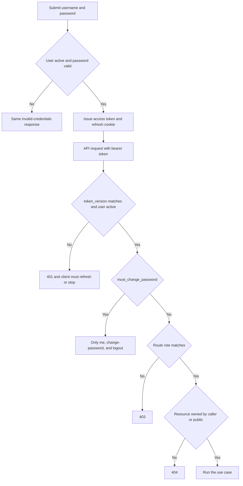

# 6. Authentication and security

Status: proposed controls. None of these controls are implemented yet. This document is the security source of truth for the hackathon build.

## 6.1 Roles

| Role | Created by | Typical surfaces |
|---|---|---|
| `CUSTOMER` | `POST /api/v1/auth/register` | Cart, checkout, own orders, own receipts, own addresses |
| `MERCHANT` | Super Admin | Own shops' products, own historical sub-orders, own receipt decisions, own analytics |
| `SUPER_ADMIN` | Seed process | Shops, merchants, categories, all orders, settlements, audit |

A user has one role. The registration route hardcodes `CUSTOMER`. No route changes `role`. Creating another Super Admin is UD-09 and is a seed change, not an API.

Authorization is enforced in services after the router checks the role. A merchant request that names another merchant's id returns `404`.

## 6.2 Session design

The client and the API are on different sites in the proposed deployment, so the session is split.

| Piece | Lifetime | Storage | Revocation |
|---|---|---|---|
| Access token | 15 minutes | Browser memory only | `token_version` on the user row |
| Refresh token | 14 days | `HttpOnly`, `Secure`, `SameSite=None` cookie | Row in `refresh_tokens` |

The access token is a JWT signed with `JWT_ACCESS_SECRET`. Claims are `sub` (user id), `role`, `tokenVersion`, `iat`, and `exp`. It does not contain the password, email, phone, or address.

Every authenticated request:

1. Verifies the signature and expiry.
2. Loads the user by `sub`.
3. Rejects the request when the user is missing, `SUSPENDED`, or `token_version` differs from the claim.
4. Rejects all routes except me, change-password, and logout when `must_change_password` is true.

The role inside the JWT is not trusted by itself. The database role is the one the service uses.

Refresh tokens are 32 random bytes, encoded for the cookie, and stored only as a SHA-256 hash. Refresh rotates the token: the presented row is revoked and a new row is inserted. If a revoked token is presented again, every refresh token for that user is revoked. That limits replay of a stolen cookie.

Logout revokes the presented refresh token. Password change and admin password reset increment `token_version` and revoke every refresh token.

The diagram file is [diagrams/authentication-flow.mmd](diagrams/authentication-flow.mmd).

## 6.3 Password hashing

Proposed algorithm: Argon2id. Starting parameters, to be checked against the current OWASP password guidance during Phase 2: 19 MiB memory, 2 iterations, parallelism 1. The hash string is stored in `password_hash`. The plaintext exists only in the request that sets it.

If the Render build cannot compile the Argon2 native module, bcrypt with cost factor 12 is the approved fallback (UD-15). The team records which algorithm shipped. Verification must detect the hash prefix so a later switch does not break existing users.

Temporary merchant passwords use the same hashing path. The create and reset responses are the only places the plaintext is returned, and audit metadata excludes it.

Login compares hashes with a constant-time verifier and always returns the same error text for unknown users, wrong passwords, and suspended users.

## 6.4 Merchant isolation

| Data | Filter |
|---|---|
| Product create, edit, archive | `shops.merchant_id = caller` and shop status is not `REMOVED` |
| Sub-order read, confirm, fulfill, cancel | `merchant_orders.merchant_id = caller` |
| Receipt decision | Payment's sub-order has `merchant_id = caller` |
| Analytics and dashboard | Same merchant id, or shops currently owned for view counts |
| Shop bank details | Shops currently owned, read-only |

Historical orders stay with the merchant who owned the shop at checkout. After an ownership transfer, the new merchant does not gain the old sub-orders, and the previous merchant does not keep catalog edit rights.

## 6.5 Customer privacy

Customers can read and change only their cart, addresses, notifications, and parent orders. Order detail includes another shop's items because the customer bought them. It does not include the merchant's login or other customers' data.

Fulfillment contact is copied onto each sub-order because the merchant must deliver or prepare pickup. That copy is the minimum: full name, phone, local address name, and house number. It excludes username. Merchants do not receive the parent grand total or sibling lines.

Admin customer detail does not dump the address book. The order snapshot is the operational copy.

## 6.6 Admin protection

- The Super Admin is seeded from environment variables that are present only at seed time. They are not written into the repository.
- There is no role-update API.
- Admin mutations write `audit_logs` in the same transaction.
- Settlement and password-reset responses are not logged at info level.
- Admin JWT claims are checked against the database like every other role, so a suspended admin token stops working.

## 6.7 Injection, validation, and uploads

Prisma parameterized queries are the default. Checkout's raw SQL, if used for `FOR UPDATE`, must pass product ids as bound parameters, never by string concatenation.

Zod schemas reject unknown fields on authentication, checkout, and AI requests. Other write routes ignore unknown fields only when a schema marks them stripped; they still cannot set `role`, `paymentStatus`, or `stockQuantity` except through the route designed for that field. A merchant cannot post `fulfillmentStatus: COMPLETED` on product create because that field is not in the schema.

Uploads:

| Upload | Types | Max size | Visibility |
|---|---|---|---|
| Product image | JPEG, PNG, WebP | 5 MB | Public Cloudinary folder `products/` |
| Bank receipt | JPEG, PNG, WebP | 5 MB | Private, signed URL for 300 seconds |

SVG is rejected. The server checks the file signature, not only the browser's content type. Receipt reads go through `GET /api/v1/payment-receipts/:receiptId`, which checks the customer, the merchant who owns that payment, or the Super Admin.

## 6.8 Rate limiting, CORS, and secrets

Proposed limits, per IP unless noted. These are targets, not measured capacity.

| Route group | Limit |
|---|---|
| Login and refresh | 10 requests per minute |
| Register | 5 requests per minute |
| AI chat | 20 requests per minute |
| Uploads | 10 requests per minute per user |
| Other API routes | 100 requests per minute |

CORS allows one configured `FRONTEND_ORIGIN`, credentials, methods `GET`, `POST`, `PATCH`, `DELETE`, and headers `Authorization`, `Content-Type`, and `Idempotency-Key`. A reflected arbitrary origin is not acceptable.

Secrets live in the host's environment, not in git:

- `JWT_ACCESS_SECRET`
- `DATABASE_URL`
- `CHAPA_SECRET_KEY`
- `CLOUDINARY_API_SECRET`
- `GEMINI_API_KEY`
- `ADMIN_INITIAL_PASSWORD` for the seed only

The Google Maps key is a browser key restricted by HTTP referrer and by API to Maps JavaScript API. It is not a server secret, and it is not an unrestricted key.

## 6.9 Chapa

1. The secret key stays on the server.
2. Checkout creates the local payment row before initialize, with a unique `tx_ref`.
3. The return URL can show a pending page. It must not mark the order paid.
4. The webhook, the retry poll from the pending page (`POST` is not used for that; the webhook and a verify step inside webhook handling are the writer), and any manual re-check all call Chapa's verify endpoint.
5. Verification updates the payment only when the provider reports success, the currency is `ETB`, and the amount equals `payments.amount`.
6. The `tx_ref` unique key and a conditional status update make verification idempotent.
7. A webhook whose verify call cannot be completed returns `500` so Chapa can retry. A duplicate success returns `200` without a second stock or settlement write.
8. UD-03: add the documented signature check when the team confirms the current header. The verify call remains mandatory either way.

The browser return URL is not a writer. The webhook is the specified writer. If a demo network blocks webhooks, Phase 8 may add a customer-authenticated refresh route that runs the same verify function. That route is not in the API specification yet. Add it to the API document before implementing it.

## 6.10 AI isolation

Controls, all required:

1. The Gemini key is server-side.
2. The model receives a fixed tool list: search, get product, compare prices, budget search, and shops for a product.
3. Tool arguments are validated. There is no tool argument for table name, SQL, user id, or order id.
4. The catalog query code selects explicit public columns from visible products and shops. It does not select `users`, `orders`, `payments`, `payment_receipts`, `refresh_tokens`, or `audit_logs`.
5. A second database role `catalog_reader` has `SELECT` only on the view `public_catalog_products`. The assistant's query path uses `DATABASE_URL_CATALOG_RO` when that role is provisioned. The application-level query list is still required if the role is not ready on demo day.
6. Logged-in callers do not add profile or order context to the prompt.
7. Transcripts are not stored.
8. Request logs store the request id and tool names, not the raw user text, because shoppers may paste secrets into the box.

The system prompt may say the assistant is a shopping helper. That sentence is not the enforcement mechanism.

## 6.11 Audit

The action list in `FR-A-12` is the minimum. Audit rows are insert-only for the application. Metadata is a structured diff of the fields that changed, with passwords, tokens, and receipt URLs removed.

## 6.12 Threat model

| Threat | Impact | Mitigation | Residual risk |
|---|---|---|---|
| Credential stuffing | Account takeover | Rate limit, generic errors, Argon2id or bcrypt | No customer recovery channel if a password is forgotten (UD-02) |
| Stolen access token | Short-lived misuse | 15-minute lifetime, memory storage, `token_version` | A token works until expiry unless the user changes password or is suspended |
| Stolen refresh cookie | Longer misuse | Hash at rest, rotation, reuse detection, `HttpOnly` | XSS on the frontend can still call the API while the user is present. React's default escaping is the main control; no raw HTML injection is allowed |
| Merchant reads another shop's orders | Competitive and personal-data leak | Service-level merchant filter and `404` | A bug that forgets the filter. Tests in the testing document are mandatory |
| Customer reads another customer's order | Personal-data leak | `customer_id` filter | Same residual: missing filter. Covered by authorization tests |
| Admin account created through registration | Full takeover | No role field on register, no promotion API, seeded admin | Seed password left in a shell history. The runbook says to change it immediately |
| SQL injection via search | Data breach | Parameterized queries and Zod limits | Raw SQL must be reviewed in checkout |
| Malicious receipt upload | Stored malware or XSS | Type and size checks, no SVG, private delivery | A polyglot file can still be stored as an image. Browsers are not asked to execute it |
| Forged Chapa webhook | Free goods | Verify with Chapa, match amount and currency, idempotent `tx_ref` | Chapa verify outage delays fulfillment. It must not mark the order paid |
| Replay of a successful webhook | Duplicate settlement or double stock decrement | Conditional status transition from non-paid to paid | None if the conditional update is actually used |
| Prompt injection against the assistant | Private-data disclosure | No private tool and a read-only catalog role | The model can still invent a product. The client renders `products` from tool output, and the UI should prefer that list |
| Public bank account scraping | Targeted fraud or spam | Bank fields omitted from public shop JSON; shown on the buyer's order | Anyone who completes checkout learns the account they must pay. That is required |
| Map key theft | Quota theft | Referrer and API restrictions | A stolen key can still be used from an allowed origin |
| Insider admin abuse | Shop or payout tampering | Audit log of admin writes | Audit does not prevent the action. The hackathon accepts a single trusted admin |
| Stock race | Oversell | `SELECT … FOR UPDATE` in product-id order | A bug that checks stock outside the transaction |

## 6.13 Security acceptance bar

The build is not ready to demo payments or the assistant until these are true in tests, not only in this document:

- A merchant token cannot read or mutate another merchant's product, sub-order, receipt, or analytics.
- A customer token cannot read another customer's order or address.
- A forged or mismatched Chapa amount does not set `PAID`.
- The assistant tool layer has no function whose implementation queries private tables, demonstrated by an injection-style test.
- Password hashes and temporary passwords do not appear in audit metadata or info logs.
