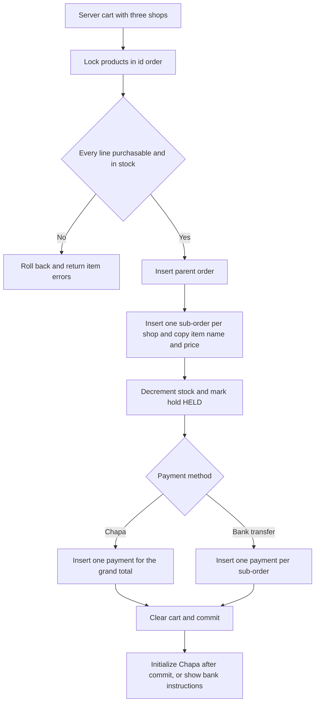
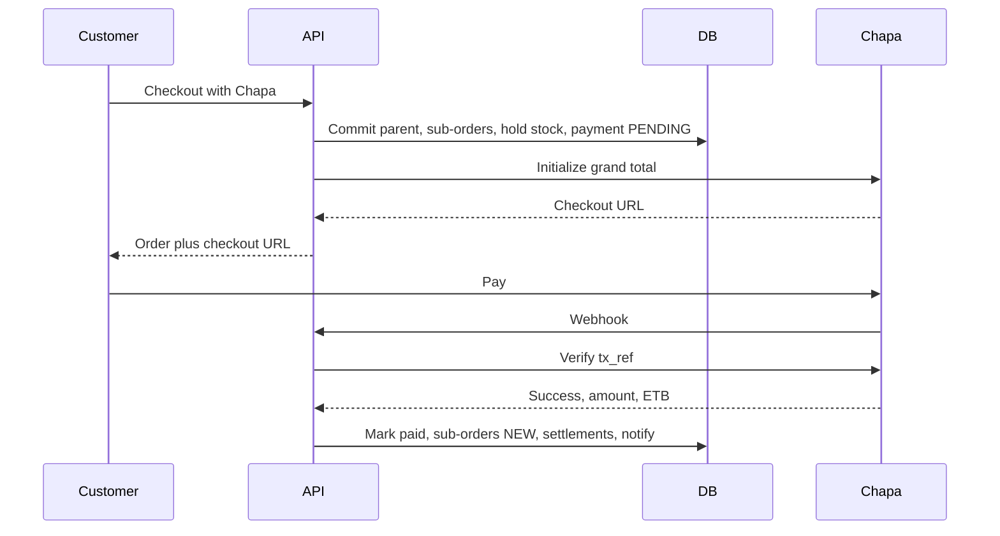
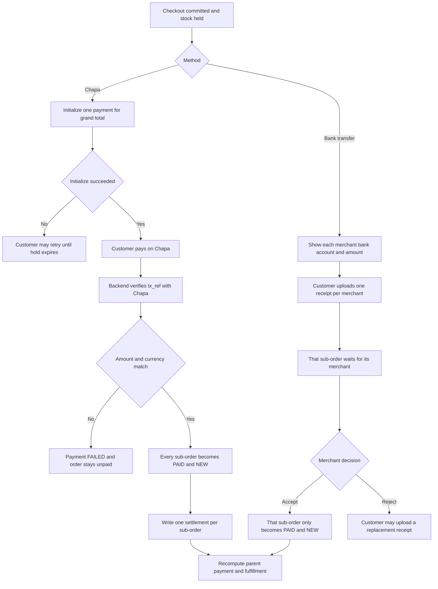

# 7. Order and payment workflows

Status: proposed behavior. This file is the source of truth for status transitions. The database stores these values. The API rejects any transition that is not listed here.

## 7.1 Parent order and sub-orders

A checkout is one customer action and several fulfillment records.

| Record | Count | What it answers |
|---|---|---|
| `orders` | One | What the customer bought, how they will receive it, and the overall totals |
| `merchant_orders` | One per shop in the cart | What that merchant must fulfill and whether that part is paid |
| `order_items` | One per cart line | The product name, unit price, and quantity at purchase time |
| `payments` | One Chapa row for the parent, or one bank row per sub-order | The money movement for that method |

Worked example, delivery fees zero:

| Shop | Item | Sub-order total |
|---|---|---|
| Shop A | Laptop | 30,000.00 ETB |
| Shop B | Shoes | 2,000.00 ETB |
| Shop C | Jacket | 3,000.00 ETB |

The parent merchandise subtotal and grand total are `35000.00`. Three sub-orders are created. Shop B's merchant sees the shoes, the customer's name, phone, address name, and house number. Shop B does not see the laptop, the jacket, or `35000.00`.

The diagram file is [diagrams/order-processing.mmd](diagrams/order-processing.mmd).

## 7.2 Initial states

Every new sub-order starts as:

| Column | Initial value |
|---|---|
| `payment_status` | `PENDING` |
| `fulfillment_status` | `AWAITING_PAYMENT` |

The parent starts as `payment_status = UNPAID` and `fulfillment_status = PENDING_PAYMENT`, with `stock_hold_state = HELD`.

Chapa hold expiry is 30 minutes after checkout. Bank-transfer hold expiry is 48 hours after checkout. Both are proposed defaults (UD-08).

Stock is decremented at checkout for every line. That decrement is a hold until the sub-order is paid, then it becomes a committed sale. Cancellation and expiry return stock once, on the transition into `CANCELLED`, and only for lines whose stock has not already been returned.

## 7.3 Fulfillment transitions

A merchant may confirm only when `payment_status` is `PAID` and `fulfillment_status` is `NEW`.

| From | To | Who | Extra condition |
|---|---|---|---|
| `AWAITING_PAYMENT` | `NEW` | Payment service | Payment for that sub-order became `PAID` |
| `NEW` | `CONFIRMED` | Merchant confirm route | Payment is `PAID` |
| `CONFIRMED` | `PREPARING` | Merchant | |
| `PREPARING` | `READY_FOR_PICKUP` | Merchant | Parent preference is `PICKUP` |
| `PREPARING` | `OUT_FOR_DELIVERY` | Merchant | Parent preference is `DELIVERY` |
| `READY_FOR_PICKUP` | `COMPLETED` | Merchant | |
| `OUT_FOR_DELIVERY` | `COMPLETED` | Merchant | |
| `NEW`, `CONFIRMED`, or `PREPARING` | `CANCELLED` | Merchant cancel route | Reason required |

No other merchant jump is valid. A merchant cannot move a sub-order to `NEW` by hand. Payment verification does that.

Customer cancellation of a placed order is not specified. The customer tracks status. The merchant can cancel their own sub-order from the three states above.

## 7.4 Payment transitions

Chapa payment row:

| From | To | Cause |
|---|---|---|
| `PENDING` | `PROCESSING` | Chapa initialize returned a checkout URL |
| `PROCESSING` | `PAID` | Verify endpoint confirmed success, amount, and `ETB` |
| `PROCESSING` or `PENDING` | `FAILED` | Verify reported failure, or a newer retry superseded the attempt |
| `PENDING` or `PROCESSING` | `EXPIRED` | Hold expiry job |

Bank-transfer payment row:

| From | To | Cause |
|---|---|---|
| `PENDING` | `AWAITING_VERIFICATION` | Customer uploaded a receipt |
| `AWAITING_VERIFICATION` | `PAID` | Owning merchant accepted it |
| `AWAITING_VERIFICATION` | `REJECTED` | Owning merchant rejected it |
| `REJECTED` | `AWAITING_VERIFICATION` | Customer uploaded another receipt |
| `PENDING` or `REJECTED` | `EXPIRED` | Hold expiry while still unpaid |

Chapa payment rows do not use `AWAITING_VERIFICATION`. Bank-transfer payment rows do not use `PROCESSING`. Sub-order `payment_status` does not use `PROCESSING` or `EXPIRED`. When a hold expires, the payment row becomes `EXPIRED` and the sub-order payment status becomes `FAILED`.

When a sub-order's payment becomes `PAID`, its fulfillment moves from `AWAITING_PAYMENT` to `NEW` in the same transaction, and the merchant receives `MERCHANT_ORDER_NEW`. For Chapa, that happens to every non-cancelled sub-order together, because there is one captured amount. For bank transfer, it happens only to the sub-order whose receipt was accepted.

## 7.5 Parent aggregation

Only the order service writes parent statuses. It runs in the same transaction as the sub-order change.

Payable sub-orders are those whose fulfillment is not `CANCELLED`.

Payment:

| Condition | Parent `payment_status` |
|---|---|
| No payable sub-orders, and a payment row is `EXPIRED` or `FAILED` | `FAILED` |
| No payable sub-orders | `UNPAID` |
| Every payable sub-order is `PAID` | `PAID` |
| At least one payable sub-order is `PAID` and another is not | `PARTIALLY_PAID` |
| Otherwise | `UNPAID` |

Fulfillment:

| Condition | Parent `fulfillment_status` |
|---|---|
| No sub-orders remain outside `CANCELLED` | `CANCELLED` |
| Every payable sub-order is `COMPLETED` | `FULFILLED` |
| At least one payable sub-order is `COMPLETED` and another is not | `PARTIALLY_FULFILLED` |
| Every payable sub-order is `AWAITING_PAYMENT` | `PENDING_PAYMENT` |
| Otherwise | `PROCESSING` |

`PARTIALLY_PAID` is therefore the bank-transfer case where Shop A has accepted a receipt and Shop B has not. The customer sees both sub-order statuses and the parent `PARTIALLY_PAID` value. Fulfillment can already be `PROCESSING` because Shop A is `NEW` or later while Shop B is still `AWAITING_PAYMENT`.

## 7.6 Chapa workflow

1. Checkout commits the order and one payment for `grand_total`, status `PENDING`, `tx_ref` unique.
2. The API calls Chapa initialize with the server secret, amount, currency `ETB`, `tx_ref`, callback URL, and return URL. Name fields come from the customer profile. Email is sent only when UD-01 says the current Chapa contract requires it, using `payer_email` on that payment.
3. On initialize success the payment becomes `PROCESSING` and the client receives `checkoutUrl`.
4. The customer pays on Chapa's site.
5. Chapa calls the webhook. The backend verifies `tx_ref` with Chapa.
6. On a confirmed match, one transaction sets the payment to `PAID`, sets each sub-order payment to `PAID` and fulfillment to `NEW`, sets the parent by aggregation, sets `stock_hold_state` to `COMMITTED`, clears the expiry, inserts one `merchant_settlements` row per sub-order, writes audit and merchant notifications. The update is conditional: it applies only when that payment is still `PENDING` or `PROCESSING` and the parent hold is still `HELD`. A late success after expiry is stored as a failed application with reason `ORDER_EXPIRED` and does not mark the payment `PAID` or restore the cancelled sub-orders.
7. On a confirmed failure, the payment becomes `FAILED`. The order stays `PENDING_PAYMENT` until expiry or a successful retry. Stock stays held.
8. The expiry job and the verify transaction use those conditional predicates so a race has one winner. If verify commits first, expiry sees a `PAID` payment and does not cancel the order. If expiry commits first, verify sees a hold that is no longer `HELD` and does not resurrect it.
9. Retry creates a new payment attempt and marks the previous open attempt `FAILED`. It does not decrement stock again.

Settlement math for each sub-order: gross is `merchant_orders.total`, fee is `PLATFORM_FEE_BPS` (proposed `0`), net is gross minus fee. Status starts at `PENDING`. The Super Admin later marks `SETTLED` after an offline payout, or `WITHHELD` if that sub-order was cancelled after capture. Bank transfer creates no settlement row.

## 7.7 Bank transfer and receipt verification

1. Checkout commits one payment per sub-order for that sub-order's `total`, including that shop's delivery fee when the preference is delivery.
2. The customer response shows each shop's bank name, account name, account number, and amount.
3. The customer uploads a receipt per sub-order. That payment becomes `AWAITING_VERIFICATION`. The merchant is notified. Fulfillment stays `AWAITING_PAYMENT`.
4. The owning merchant accepts or rejects. Acceptance follows the paid transition in section 7.4. Rejection sets `REJECTED` and notifies the customer, who may upload again.
5. One merchant's decision does not change another merchant's payment.

A customer can be looking at a parent order where the laptop payment is `PAID` and `CONFIRMED`, the shoes payment is `AWAITING_VERIFICATION`, and the jacket payment is `REJECTED`. Those three states are valid together.

## 7.8 Hold expiry

The job runs in the API process every five minutes and claims due rows with a conditional update so two runners cannot release the same hold twice.

Chapa: if the parent is still `PENDING_PAYMENT`, the hold is `HELD`, and no payment is `PAID`, expiry marks open payment rows `EXPIRED`, sets each sub-order payment status to `FAILED`, cancels every sub-order, returns all stock, and re-aggregates. The parent fulfillment becomes `CANCELLED`, the parent payment status becomes `FAILED`, and the hold becomes `RELEASED`.

Bank transfer: each still-unpaid sub-order (`PENDING` or `REJECTED`) is cancelled, its payment status becomes `FAILED`, its payment row becomes `EXPIRED`, and its stock is returned. Sub-orders already `PAID` are left as they are. The parent is then re-aggregated. If at least one paid sub-order remains, the hold becomes `COMMITTED`. If every sub-order is cancelled, the hold becomes `RELEASED` and the parent payment status becomes `FAILED`.

## 7.9 One merchant cancels

Cancellation is allowed from `NEW`, `CONFIRMED`, or `PREPARING`.

- That sub-order's fulfillment becomes `CANCELLED`.
- Its stock is returned once.
- Its payment status is not rewritten. A captured Chapa sub-order stays `PAID` and its settlement becomes `WITHHELD`. An unverified bank payment stays unpaid and is excluded from the payable set because the sub-order is cancelled.
- Sibling sub-orders are unchanged.
- The parent is re-aggregated. A five-shop order with one cancellation remains open for the other four.

Automated refund of the captured Chapa amount is out of scope (UD-05). The withheld settlement tells the admin not to pay that merchant. Any customer refund is a manual decision outside this version.

## 7.10 Suspended merchant or hidden product during checkout

If any product in the cart is archived, unavailable, out of stock, or belongs to a shop or merchant that is not `ACTIVE`, checkout fails entirely and names the bad lines. No partial parent order is written. The customer removes or changes those lines and submits again.

Suspension after a successful checkout does not delete the order. The merchant cannot log in to advance it until reactivation. The customer still sees the existing statuses. The admin still sees the transaction.

## 7.11 Payment flow diagram

The diagram file is [diagrams/payment-flow.mmd](diagrams/payment-flow.mmd).

## 7.12 Worked partial-payment reading

For the 35,000 ETB example paid by bank transfer:

| Shop | Payment status | Fulfillment | Customer sees |
|---|---|---|---|
| Shop A | `PAID` | `PREPARING` | Laptop is being prepared |
| Shop B | `AWAITING_VERIFICATION` | `AWAITING_PAYMENT` | Shoes receipt is waiting |
| Shop C | `PENDING` | `AWAITING_PAYMENT` | Jacket receipt has not been uploaded |

Parent payment status is `PARTIALLY_PAID`. Parent fulfillment status is `PROCESSING`. The admin sees the same three sub-orders plus receipt metadata. Shop A does not see Shop B's receipt.
