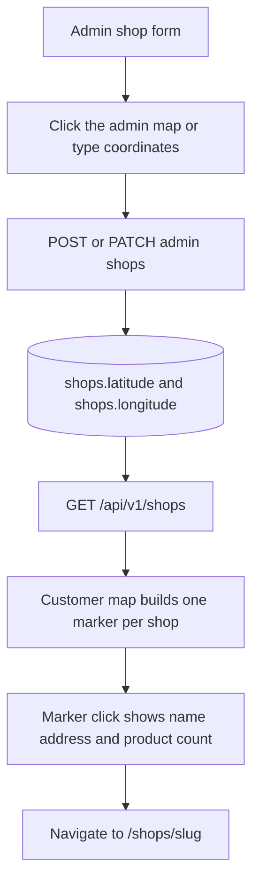

# 8. Google Maps integration

Status: proposed. No Maps key is provisioned in this repository, and no map is implemented.

## 8.1 Responsibility split

| Concern | Owner |
|---|---|
| Latitude and longitude values | PostgreSQL `shops.latitude` and `shops.longitude` |
| Who may write them | Super Admin, through the shop create and update API |
| Who may read them for the public map | Anyone, through `GET /api/v1/shops` |
| Rendering markers | The React app, using the Google Maps JavaScript API |
| Geocoding a street address | Not used. The admin pin is the source of truth |

The landing page centers on Jimma (`7.6667`, `36.8333`, zoom `13`) only as a camera default. Shops outside that view still exist and appear when the customer pans or searches, provided the optional bounding box includes them.

## 8.2 Registering a coordinate

1. The Super Admin creates a merchant if needed.
2. The admin opens the shop form and enters name, description, phone, address text, delivery fee, and bank details.
3. The form shows a map. Clicking the map writes latitude and longitude into the form fields. The admin can also type the numbers.
4. `POST /api/v1/admin/shops` or `PATCH /api/v1/admin/shops/:shopId` validates the ranges and stores the decimals at six places.
5. The next public `GET /api/v1/shops` includes the shop only when its status is `ACTIVE` and its merchant is `ACTIVE`.

Editing a location repeats steps 3 and 4. Existing orders do not store the pin.

## 8.3 Customer map behavior

On load, the client requests the first page of active shops. For the hackathon size, the client may request a page size of 50 and follow pages until the map has every active shop, or it may send the current map bounds as `swLat`, `swLng`, `neLat`, and `neLng`. Bounds are the preferred call once the shop count grows. Both shapes are in the API specification.

Each returned shop becomes a marker at its exact stored coordinate. Marker clustering is enabled through the Maps marker clusterer so nearby Jimma stalls do not stack into an unreadable pile. Clusters expand on click. A cluster is a display aid; it does not change shop identity.

Marker click opens a preview card:

- shop name;
- address text;
- `productCount`;
- a control that navigates to `/shops/:slug`.

The preview does not show bank details. The shop page then loads `GET /api/v1/shops/:slug` and `GET /api/v1/products?shopId=`.

The same page shows a text list of the shops currently in view. Selecting a list row opens the same preview. Discovery does not depend on being able to tap a small marker.

## 8.4 Search and filtering

| User action | API |
|---|---|
| Search shop names | `GET /api/v1/shops?q=` |
| Find shops that sell a product | `GET /api/v1/shops?product=` |
| Filter by category | `GET /api/v1/shops?category=` |
| Pan or zoom | The same route with a bounding box |

The map replaces its markers with the filtered set. Clearing the filter reloads the unfiltered shops in view. Product text search on the dedicated search page uses `GET /api/v1/products` and links to the shop; it does not require the map, but each result can offer "show on map" by centering the camera on that shop's coordinates from the product detail payload.

## 8.5 Keys and cost

The browser key is restricted to:

- the Maps JavaScript API;
- HTTP referrers for local development and the Vercel frontend origin, once that origin exists.

The key is not used on the server. The server does not call Geocoding, Places, or Directions in this version. Those products are extra scope and extra billing.

The key value is not recorded in this documentation.

## 8.6 Responsive behavior

| Viewport | Layout |
|---|---|
| 360 px wide | Map on top, about 50 vh, shop list below, preview as a card under the map |
| 1280 px wide | Map and shop list side by side, preview anchored to the list |

Touch targets for marker alternatives are the list rows. Zoom controls remain visible. The page does not capture scroll in a way that traps the customer inside the map on a phone; a two-finger gesture preference should be tested on a real device during Phase 4. That gesture behavior is a target, not a verified result.

## 8.7 Failure behavior

If the Maps script fails to load, the shop list still renders from `GET /api/v1/shops` and each row links to the shop page. Map failure must not block search, cart, or checkout. The client shows a short message that the map could not be loaded.
