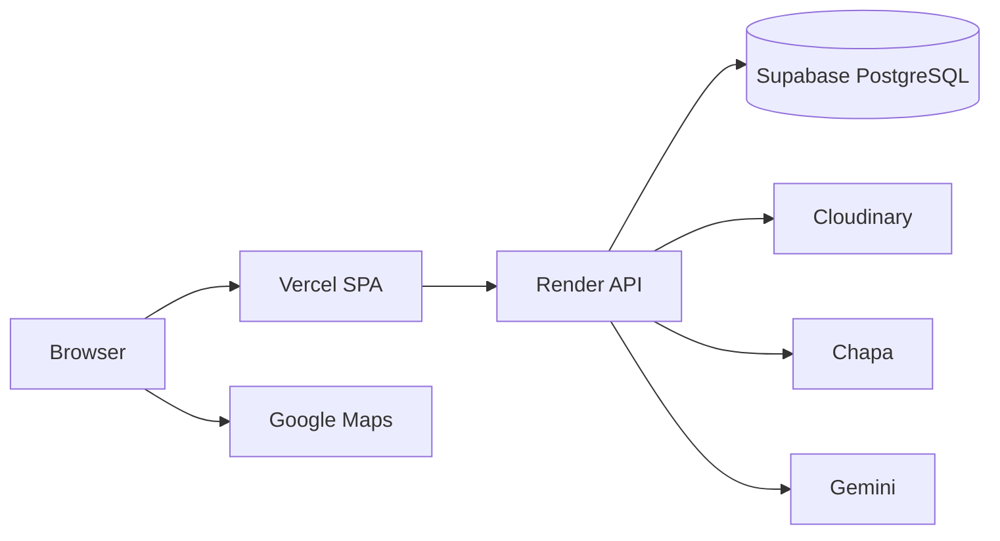

# 12. Deployment and infrastructure

Status: proposed target. This repository does not contain a frontend, a backend, a Dockerfile, or hosted project URLs. No Vercel, Render, or Supabase project is claimed to exist.

## 12.1 Target topology

| Part | Proposed host | What runs there |
|---|---|---|
| React SPA | Vercel | Static frontend. Holds the referrer-restricted Maps key and the public API origin |
| Express API | Render web service | Modular monolith, including the hold-expiry loop |
| PostgreSQL | Supabase | The database in [04-database-design.md](04-database-design.md). Supabase Storage is not the image store |
| Images | Cloudinary | Public `products/` and private receipts |
| Payments | Chapa | Initialized and verified only by the API |
| Assistant model | Gemini API | Called only by the API |

One Render service is intentional. It matches the modular monolith. Horizontal scaling is a later change and must keep the expiry job's conditional update.

## 12.2 Environments

| Environment | Purpose | Data |
|---|---|---|
| Local | Development | Local or separate Supabase database, test keys |
| Preview | Optional hosted check of a branch | Separate Supabase database and Cloudinary folder prefix. Not production receipts |
| Production | Hackathon demo | Only after seed and backup are confirmed |

Preview and production do not share a database. Test payments use Chapa's test mode if the team enables it. This document does not record a test-mode result, because none has been run.

## 12.3 Configuration

The API process reads:

| Variable | Required | Notes |
|---|---|---|
| `DATABASE_URL` | Yes | Runtime connection. Prefer the pooler URL Supabase documents for application traffic |
| `DIRECT_DATABASE_URL` | Yes for migrations | Direct connection for Prisma migrations. Pooler transaction mode is a poor migration channel |
| `DATABASE_URL_CATALOG_RO` | No | Catalog-reader role. Assistant falls back to fixed queries on the main connection if absent |
| `JWT_ACCESS_SECRET` | Yes | Long random secret |
| `ACCESS_TOKEN_TTL_SECONDS` | No | Default `900` |
| `REFRESH_TOKEN_TTL_SECONDS` | No | Default `1209600` |
| `FRONTEND_ORIGIN` | Yes | Exact SPA origin for CORS and cookie rules |
| `CLOUDINARY_CLOUD_NAME` | Yes | |
| `CLOUDINARY_API_KEY` | Yes | |
| `CLOUDINARY_API_SECRET` | Yes | |
| `CHAPA_SECRET_KEY` | Yes when payments are enabled | Server only |
| `CHAPA_CALLBACK_URL` | Yes when payments are enabled | Public webhook URL on the API host |
| `CHAPA_RETURN_URL` | Yes when payments are enabled | Frontend pending page |
| `GEMINI_API_KEY` | Yes when the assistant is enabled | |
| `GEMINI_MODEL` | Yes when the assistant is enabled | Chosen in Phase 10 |
| `PLATFORM_FEE_BPS` | No | Default `0` |
| `STOCK_HOLD_MINUTES` | No | Default `30`, used for Chapa |
| `BANK_TRANSFER_HOLD_HOURS` | No | Default `48` |
| `ADMIN_USERNAME` | Seed only | |
| `ADMIN_INITIAL_PASSWORD` | Seed only | Change after first login. Do not leave the seed value in service env longer than the seed run if the host keeps old env revisions |
| `PORT` | Set by Render | |

The SPA reads:

| Variable | Notes |
|---|---|
| `VITE_API_ORIGIN` | Render API origin, no secret path |
| `VITE_GOOGLE_MAPS_API_KEY` | Referrer-restricted Maps JavaScript key |

No variable in this table has been given a real value in the documentation.

## 12.4 Build and release shape

These commands are the intended shape once the application exists. They are not scripts in the repository today.

- Frontend: install, typecheck, test, production build, deploy the build to Vercel.
- Backend: install, typecheck, test, compile TypeScript, start `node dist/server.js`.
- Migrations: `prisma migrate deploy` using `DIRECT_DATABASE_URL`, before the new instance serves traffic.
- Seed: a one-shot command that creates the Super Admin if that username is absent. It does not reset a merchant's password on every deploy.

Render's health check path is `GET /api/v1/health`.

Cookie settings for the cross-site SPA require HTTPS in preview and production. Local HTTP development should use a documented exception, such as a Vite proxy that makes the API same-origin on localhost, so developers do not weaken production cookies to `SameSite=None` without `Secure`.

## 12.5 Data protection in hosting

- Render and Supabase access are limited to the team accounts available for the hackathon. This document cannot name those accounts because they are not part of the specification.
- Database backups follow the Supabase plan the team actually enables. The proposed targets are RPO 24 hours and RTO 4 hours, from the architecture document. They remain targets until a restore has been rehearsed.
- A restore rehearsal is a Phase 11 task: restore into a throwaway database and read one parent order. It is not optional paperwork if the demo will store real receipts.
- Cloudinary receipt folders are private. Product folders are public.
- Logs on Render follow the logging rules in the security document.

## 12.6 Domain and callback names

No production domain is assigned in this specification. Webhook and return URLs are derived from the deployed API and SPA origins when those origins exist. They should be filled into the host environment, not committed.

## 12.7 What not to deploy from this repository today

The current repository is documentation. Deploying it to Vercel or Render would publish Markdown, not a marketplace. Phase 11 is the first phase that should create hosted environments.
